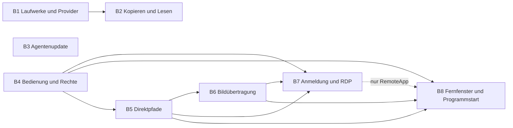

# Detailplan für die nächsten Entwicklungsläufe

Stand: 2026-10-25. Planungsbasis: Commit `aec62a40`; `native/Cargo.toml` und `release-native/update-feed/version.txt` nennen `0.5.184`. Diese Versionsangabe ist kein neuer Veröffentlichungsnachweis. Es wird keine nächste Versionsnummer reserviert.

**Auftragsgrenze:** Der Nutzer hat am 2026-10-25 ausdrücklich festgelegt: „du stoppst wenn der plan steht, du setzt ihn noch nicht um“. Dieses Dokument plant die Änderungen und ihre spätere Abnahme. Verbindliche Detailverträge stehen in [vertraege.md](vertraege.md) und [agentenvertrag.md](agentenvertrag.md); Kritik und Befundbearbeitung in [kritik.md](kritik.md). Es startet keine Umsetzung, Suite, Messung an Nutzerdaten, Installation, Versionsänderung oder Veröffentlichung. Ein späterer Umsetzungsauftrag beginnt mit dem dann aktuellen Bestand.

## A — Erstplan aus dem Auftrag

### Ergebnis und Quellen

Der Auftrag vom 2026-10-24 lautet: „fass die aufgaben in vernünftige batches zusammen und strukturiere sie sauber. danach wähle die entsprechenden models aus. das ziel im prinzip bleibt so wenig agents wie möglich. so viele wie nötig.“ Die Korrektur desselben Tages lautet: „für planung gibt es eine bestimmte vorgehensweise in der arbeitsweise. der ist eigentlich zu volgen und erst danach kann man die umsetzungsagenten und batches wirklich zuteilen.“ Die aktuelle Grenze vom 2026-10-25 beendet diesen Auftrag nach dem fertigen Plan.

Das Ergebnis besteht deshalb aus der Bestandsgrundlage B, den begründeten Entscheidungen C, dem konkreten Arbeitsplan D, einer vollständigen Zuordnung der P-Punkte zu späteren Entwicklungsläufen und der anschließenden Modellwahl durch den Hauptagenten. Die Planung selbst vergibt keine Umsetzungsaufträge.

Die Anforderungsquellen sind:

- [Fernzugriff und Desktop](../2026-10-22-fernzugriff-desktop/machbarkeit.md): P1–P9, P27–P31, E1–E6 und E14; darin steht der Wortlaut der einzelnen Rückmeldungen.
- [Laufwerke, Medien und Agenten](../2026-10-22-laufwerke-medien-agenten/machbarkeit.md): P10–P26, E9–E13.
- [Projektziel](../../RICHTUNG.md): Direktverbindung, zentral sichtbare Geräterechteliste, allgemeine TCP-Weiterleitung als RDP-Grundlage und Zielgerät als Parameter des Programmstarts. Geteilte Prozesse und Hardware sind kein Teil dieses Auftrags.
- [Planungsbelege](recherche.md): Erstplan des Hauptagenten, Bestandsprüfung, beide Recherchegänge und datierte Primärquellen. Die älteren Machbarkeitsnotizen sind die Herkunft der Anforderungen; ihre Annahmen werden durch die Entscheidungen dieses Plans präzisiert.

### Vollständiger Umfang

Aktiv sind genau diese 27 Punkte: **P1, P2, P3, P4, P5, P6, P7, P9, P10, P11 Stufe 1, P13, P14, P15, P16, P17, P18, P19, P20, P21, P22, P23, P24, P26, P27, P28, P29 und P30**. P31 ergänzt die Darstellungsentscheidung und die Bildstromverbesserungen; es ist kein pauschaler Auftrag für das Abfangen fremder Zeichenbefehle.

Ausgeschlossen bleiben **P8** als Bestandshinweis, **P11 Stufen 2 und 3**, **P12** als Disc-Rohzugriff/Dateisystemrettung und **P25** als optionaler Ersatz von Dokany. **E7, E8 und E13** sind deshalb inaktiv. Ton, Bildschirm-Zwischenablage, neue allgemeine Codecs, verteilte Prozesse, USB-over-IP, Layer-2-Netze, Drucker- und SPS-Produktfunktionen werden nicht eingeführt. Die in `docs/TODO.md` außerhalb dieser Punkte geführte Arbeit bleibt außerhalb des Plans.

### Erstplan und fehlende Angaben

Vor der Detailplanung wurde folgender Ablauf aus dem Auftrag festgehalten: vorhandene Verträge zuordnen; Alternativen anhand aktueller Primärquellen beurteilen; Sicherheits- und Oberflächenentscheidungen schließen; Meilensteine mit objektivem Ergebnis definieren; verbleibende API-/Plattformlücken erneut recherchieren; erst daraus Batches ableiten. Der Erstplan steht in `recherche.md`, Abschnitt „Auftrag und Erstplan“.

Planungstiefe **4** ist erforderlich: P28 verändert den gemeinsamen Datenweg; P18 verändert die Eigentümerschaft von Rechteoberflächen; P1 führt privilegierte Helfer und einen TCP-Vertrag ein; P4/P5 verbinden Fenster, Programme, Rechte und native Oberflächen. Die kleineren Fehler bleiben eigenständige Meilensteine innerhalb dieser Gesamtplanung.

Nicht bekannt sind die konkrete Ursache des beobachteten Linux-Greeter-Eingabefehlers, des verschmierten Android-Bildes und der wiederkehrenden Drive-Abmeldung sowie der vom Nutzer gemeinte Auswahlfenstertyp. Diese Angaben verhindern keine Planung: D definiert Diagnosefragen, kontrollierte Vergleichsfälle und Entscheidungskriterien. **Annahme zu P16:** Gemeint ist zuerst der eingebaute Ordnerpicker, weil sein Inhalt aus einer horizontalen Zeile eine kleine Resthöhe ableitet; alle eingebauten Auswahlfenster bleiben im Inventarumfang. Unbekannte Kontodaten, Betriebssystemkonfigurationen und Gerätemesswerte werden nicht erfunden.

## B — Zweitplan aus dem Bestand

### Geprüfte Wiederverwendung und Grenzen

Die Architektur wurde über `docs/ARCHITEKTUR.md`, `docs/oberflaechen/INDEX.md`, beide Machbarkeitsnotizen und gezielte Quelltextlektüre eingegrenzt. Der vorhandene Graph wurde lesend abgefragt; er ist Navigation, kein Laufzeitbeweis. Für diesen Plan wurden aus der Abfrage `mount rooted spool permission desktop` die Fundstellen `MountConfig`, `mount_manager_start.rs`, `spool.rs`, `path.rs` und `desktop_surface_host.rs` übernommen. Es erfolgte kein Graphneubau.

| Bestandsvertrag | Beleg und Wiederverwendung | Konkrete neue Arbeit |
|---|---|---|
| Ort und Gegenstelle bleiben eine Identität | `connect/core/location.rs`, `connect/os/shared/resolution.rs`; Backend, Verbindung und Literalpfad werden gemeinsam aufgelöst | Neue Mount-, Transfer- und Rechtewege nehmen denselben typisierten Ort an. Kein Remote-Locator wird als lokaler Pfad behandelt. |
| Einhängen erfordert einen Wurzelbeweis oder ausdrücklich gespeichertes Vertrauen | `daemon/os/shared/rooted_backend.rs::new_in` weist `Enforced` ohne `RootConfinement` zurück; `vault/os/shared/backend.rs` reicht die Aussage des Speichers durch | P21 ergänzt nachweisbare Eingrenzung und gebundenes Vertrauen; die Abweisung selbst bleibt wirksam. |
| Automatisches Tresor-Einhängen besitzt schon einen zentralen Weg | `daemon/os/shared/mount_paths.rs::ensure_mounted_for` sucht vorhandene Einträge, versucht Recovery und erzeugt sonst `MountConfig::new` | Derselbe Weg muss gültige Rootpolicy, Schreibrechte und bevorzugten gesunden Mount auswählen; keine zweite UI-Sonderimplementierung. |
| Mount-Recovery enthält mehr als Dateien | `mount/core/journal_record.rs` führt `PersistedEntry`, `PersistedDelete`, `NamespaceIntent`; `spool.rs`, `stage_ledger.rs`, `delete_recovery.rs`, `namespace_recovery.rs` | P22 braucht ein vollständiges Recovery-Paket einschließlich Lösch-/Umbenennungszustand, Baseline und Stagebezug. |
| Ordnerkonflikte unterscheiden heute lokale und Remote-Ziele | `transfer/os/shared/engine/folders.rs`; `app/core/transfer_route.rs`; `mobile/os/shared/fs_edit.rs` | P14 trennt ausdrücklich den obersten Zielordnerkonflikt vom Dateikonflikt darunter. |
| CLI-Ziel ist ausdrücklich adressiert | `cli/engine_copy.rs` dokumentiert den getippten Zielnamen; bestehende Ziele gehen noch über `ops`/`tree_ops` | Eine neue Ordneroption muss beide Pfade erreichen; bestehende `se cp`-Skripte dürfen ihre Zielbedeutung nicht wechseln. |
| Ein Iroh-Endpunkt trägt mehrere Datenwege | `share/core/node.rs`, `session.rs::endpoint_addr`; `Cargo.lock`: Iroh 1.3.0 | P28 braucht eine gemeinsame Pfadpolitik und Nutzdatenzulassung für Datei-/Mount-/Sync-, Exec-/Terminal- und Bildschirmkanäle. |
| Iroh bevorzugt bereits IP vor Relay | Versionsgebundene Untersuchung in `recherche.md`: `BiasedRttPathSelector` behandelt IP als Primary, Relay als Backup; `PathSelector::select` wählt den Nutzdatenpfad. Noq kann Backup verwenden, wenn kein Available-Pfad bleibt | Nicht eine erfundene allgemeine Relay-Präferenz beheben. Neu sind LAN vor WAN, belegtes Ende der Direktversuche und sichtbarer Rückfall. Weder `PathSelection::none()` noch `Backup` blockieren Nutzdaten; D5 enthält deshalb die zusätzliche QUIC-Schedulergrenze. |
| Rechte besitzen eine gemeinsame Fähigkeitsliste | `share/core/access_grant.rs`: `ExecCommands`, `ExecTerminal`, `ScreenView`, `ScreenControl`; fehlende Entscheidung = `Off` | P18 bildet echte Rechtequellen ab. P1/P5 ergänzen Fähigkeiten, ohne Altgrants automatisch zu erweitern. |
| Bildschirm hat bereits Capture, Workerprozess, Kachelcodec und Video | `screen/core/`, `screen/os/`, `app/core/screen_viewer_app.rs`, Android `ScreenEncoder.kt`/`ScreenViewScreen.kt` | P6/P7/P27/P30/P31 erweitern Sichtbarkeit, Regelung, Bildrekonstruktion und Aushandlung; P4 verwendet sie für einzelne native Fenster. |
| Plugin-Auffrischung existiert beim MCP-Start | `cli/plugin/files.rs`, `cli/mcp/server.rs`; `cli/mcp/update_stop.rs` beendet den Server beim Desktop-Update | P13 verschiebt die Auffrischung an den erfolgreichen Updateabschluss und erhält kompatible laufende Sitzungen, ohne Hotswap zu behaupten. |
| Drive-Refresh bewahrt fehlenden neuen Refresh-Token | `cloud/core/token_persistence.rs`; `cloud/core/cloud.rs`; Wiederanlauf in `daemon/os/shared/job_recheck.rs` | P26 ergänzt koordinierte Persistenz und differenzierte Authzustände. Sieben Tage allein beweisen keinen OAuth-Testmodus. |

### Zu erhaltende Verträge für sämtliche Meilensteine

**K1 Orte und Namen:** lokale Pfade, UNC und gemappte Laufwerke, SFTP einschließlich SSH-Agent, FTP/FTPS, WebDAV, Google Drive, Direct Share, Room Share und Tresor-Locators behalten Backend, Verbindung, Root und Literalnamen. Gleichlautende Pfade auf zwei Gegenstellen bleiben verschieden. Bestehende gespeicherte Locator werden gelesen; Migrationen sind atomar und rücknehmbar.

**K2 Rechte:** Rechte des tatsächlichen Providers, Nur-Lesen, Kontakt-/Raumidentität, Ablauf, Rückfragen, Policyrevision und Entzug gelten am Host bei jeder Zulassung und im laufenden Kanal. Discovery und Transport sind keine Autorisierung. Ein unbekanntes neues Recht ist aus. Technische Unverfügbarkeit wird von fehlender Berechtigung getrennt angezeigt.

**K3 Dateisicherheit:** Quelle bleibt bis zur bestätigten Zielveröffentlichung erhalten; Fehler dürfen weder erfolgreich aussehen noch die Baseline fortschreiben. Backup-/Konfliktkopiefehler verhindern zerstörende Schritte. Links/Junctions werden bei Scan, Vorschau, Kopie und Sync als geschützte Auslassungen geführt; keine Rekursion außerhalb des autorisierten Roots. Ein Teilscan ist kein vollständiger Incrementalindex. `node_modules` ist kein Ausschlusskriterium.

**K4 Lebenszyklus:** Abbrechen, Rechteentzug, Verbindungswechsel, Sitzungsende, App-Hintergrund, Daemon-Neustart und Update erhalten wiederholbare Operationen. Wiederverbinden wiederholt keine mutierende Anfrage ohne bestätigte Idempotenz. Zugangsdaten, PINs, Passwörter, Tastatureingaben und Klartextinhalte erscheinen nicht in Logs.

**K5 Oberflächen:** Die acht Projektoberflächen sind Desktop Windows/Linux, Android-App, CLI Text/JSON, MCP, Android-Bridge, Daemon-IPC, Netzvertrag und Dokumentation. D benennt je Punkt die tatsächlich berührten Oberflächen und begründete Ausnahmen. Ein GUI-Umbau entfernt keine CLI-/JSON-Felder. Neue Protokollfähigkeiten werden ausgehandelt; alte Peers erhalten den vorhandenen konservativen Weg.

**K6 Architektur:** Neue oder wesentlich geänderte Rustmodule bleiben unter 500 Zeilen und 50 KiB. Bestehende große Dateien werden vor sinnvoller Erweiterung nach Verhalten zerlegt. `core` enthält Modelle und Entscheidungen; OS-Zugriffe, Credentials, Prozesse und Dateisystemdetails liegen hinter `os`. Neue Dateien in D sind ausdrücklich geplante Module, keine Behauptung vorhandener Dateien.

## C — Entscheidungsplan

### Getroffene Entscheidungen E1–E14

Die Entscheidungsvollmacht für E1–E6 und E9–E12 ist in den Machbarkeitsnotizen vom 2026-10-22 festgehalten. E14 kam mit P31 am 2026-10-24 hinzu. Eigene Ableitung: Die allgemeine Vorgabe „Selbst entscheiden“ und der aktuelle Planungsauftrag decken seine technische Auswahl; E14 wird nicht rückwirkend der früheren Nachricht zugeschrieben. Die folgenden Entscheidungen gelten als **Planentscheidungen**, nicht als bereits eingerichtete Fähigkeiten.

| Entscheidung | Gewählter Weg und Begründung | Verworfen oder abgegrenzt |
|---|---|---|
| **E1** Windows-Anmeldung | Optional administrativ installierter LocalSystem-Broker und separater unprivilegierter Boot-Netzdienst mit eigener Maschinenidentität; pro berechtigter Sitzung separater Capture-/Input-Helfer. V1 bestimmt unabhängige Anforderungssignaturen, geschützten Hashbestand sowie Installation und Update. Netzwerk, Peerparser und Videocodecs bleiben im unprivilegierten Prozess. DXGI für den sicheren Desktop; `SendSAS` nur nach eigener Policyprüfung und unterstützter Systemrichtlinie. | Ein netzwerkfähiger SYSTEM-Daemon, frei wählbare Helferpfade und das Abschalten von UAC/NLA sind ausgeschlossen. WGC auf Winlogon ist keine Planvoraussetzung. |
| **E2** RDP | Zweiter, ausdrücklich gewählter Weg über einen gerätegebundenen allgemeinen TCP-Tunnel. Zuerst vorhandene System-/Herstellerclients über geprüfte Startadapter; kein neuer eingebetteter RDP-Parser. Windows-Edition, Linux-Servermodus, Zertifikatsvertrauen und lokale Sitzungswirkung werden vor dem Start gezeigt. | RDP ersetzt den gemeinsamen Bildschirm nicht. Android ist Betrachter, kein RDP-Host. Kein implizites `accept all certificates`; kein Passwort in URI, `.rdp`, Prozessargument oder Log. |
| **E3** Android-Fenster | Normale Android-App mit vom System erlaubter Einzel-App-Projektion und tatsächlichen Launch-Fähigkeiten. Der Androidhost gibt eine vom Nutzer gewählte App pro Projektion frei; der Androidbetrachter kann unabhängig davon Fenster unterstützter Windows-/X11-Hosts auswählen. | Shizuku, root, Wireless-Debugging und OEM-Sonderintegration gehören nicht in diesen Lauf. Sie erhöhen Installation und Privilegien und sind für den gesicherten Einzel-App-Weg nicht nötig. Gleichzeitig fernbedienbare Apps desselben normalen Androidhosts werden nicht zugesagt; die Mehrfenstergrenze wird sichtbar benannt. |
| **E4** Programmstart | Eigenes Recht `app_launch`, mit Hostkatalog und erlaubten App-IDs, Sitzung und optionaler Rückfrage. Der Auftrag enthält Zielgerät und App-ID; kein frei zusammengesetzter Shellbefehl. | Das Befehls-/Terminalrecht gewährt keinen stillen Programmstart in der interaktiven Sitzung. Die Berechtigungen für Exec-Konten bleiben getrennt. |
| **E5** Anmeldung | Eigene Fähigkeit für Zugang zu Anmeldung/Sperrbildschirm; zusätzlich `screen_view`, für Eingaben zusätzlich `screen_control`. Standard `Off`, nur ausdrücklich gewährte direkte Gerätebeziehung, Widerruf beendet sichere Capture-/Input-Sitzungen. Dauerhafte Zustimmung am Host ist vor dem Sperren möglich; ein gesperrter Host bestätigt keine neue Rückfrage selbst. | Kein Erben aus gewöhnlichem Steuern, Raumbeitritt oder Discovery. UAC-/Anmeldezugang wird nicht als harmlose Bildschirmeinstellung dargestellt. |
| **E6/E11** Reihenfolge | Die endgültige Reihenfolge ergibt sich erst nach D aus Dateien, Integrationsgrenzen und Abhängigkeiten; siehe Batchmatrix. Kleine Fehler bleiben erkennbare Teilmeilensteine, ohne eigene Test-/Releasezyklen. | Die frühere Reihenfolge „fünf Batches, kleine Punkte zuerst“ ist kein bindender Zuschnitt. Mehrere voneinander unabhängige Sicherheitsverträge werden nicht allein zur Reduktion der Releasezahl zusammengelegt. |
| **E9** Agentenupdate | **A und B**, technisch getrennt: atomare Auffrischung aller verwalteten Einbindungen beim erfolgreichen Update; laufende kompatible MCP-Prozesse behalten ihre geprüfte alte Laufzeit bis zum Sitzungsende. Windows verwendet geprüfte Versionen nebeneinander statt einer unbelegten Umbenennung der laufenden EXE. | **C** wird nicht umgesetzt: kein transparenter Server-Hotswap mit wiederholtem `initialize`. Werkzeugliste, offene Calls, Cancellation, Zugriffszustand und Clientcaches lassen sich nicht durch `list_changed` allein migrieren. Ein notwendiges einmaliges Neuverbinden beim Übergang vom Altbestand wird ehrlich angezeigt. |
| **E10** Ordnerkonflikt CLI/MCP | Der ausdrücklich eingegebene Zielordner und das heutige Zusammenführen bleiben Standard. Eine explizite Option wählt `merge`, `keep-both` oder `fail`; Text/JSON nennen den tatsächlichen Zielpfad. GUI/Android erhalten dagegen bei Kollision den Dialog mit Standard „Beide behalten“. | Keine stille Änderung bestehender `se cp`-/MCP-Aufträge. Dateikonflikte (`rename`, `overwrite`, `skip`) werden nicht mit dem obersten Ordnerkonflikt vermischt. |
| **E12** Einstellungen | Ein erreichbarer Einstieg mit **Dieses Gerät; Geräte; Räume; Verbindungen; Sync; Tresore; Laufwerke; Integration; Darstellung; Updates; Hintergrund; Diagnose und Protokolle**. Geräterechteseite zeigt eine gemeinsame Fähigkeitsliste und die jeweilige Herkunft des wirksamen Rechts. | Keine neue Rechtepersistenz nur für die GUI. Funktionsübersichten bleiben erreichbar und verlinken die zuständige Geräteseite; eine Raumregel wird dort nicht versehentlich als Direktgrant bearbeitet. |
| **E14** Fernfenster | Eigener, versionierter Fensterstrom aus Video und verlustfreien Regionen als allgemeiner Weg. Windows-DXGI-Move-/Dirty-Rects werden bei tatsächlich vorhandenen Metadaten genutzt; WGC-, X11-, Wayland- und Android-Quellen bleiben mit Bildvergleich nutzbar. RemoteApp ist ein zusätzlicher Adapter für tatsächlich unterstützte RDS-Konfigurationen. | Keine Injektion in fremde Programme, kein plattformübergreifendes Abfangen beliebiger Zeichenbefehle. RDP auf Pro/Enterprise beweist **keine** RemoteApp-Unterstützung: Microsoft nennt dafür Windows Server. Kein inoffizieller Registry-Unlock. |

E7/E8/P12 sowie E13/P25 bleiben inaktiv. Die Quelle für die RDP-/RemoteApp-Trennung ist [Microsoft Supported configurations](https://learn.microsoft.com/en-us/windows-server/remote/remote-desktop-services/remotepc/remote-desktop-supported-config), geprüft am 2026-10-25. Quellen und Vertragsdetails der übrigen Entscheidungen stehen in `recherche.md`; gerätespezifische Messgrenzen stehen in D.

### Eigene Sicherheitsprüfung der Entscheidungen

| Bereich | Konkreter Angriffs-/Verlustweg | Verbindliche Grenze und späteres Abnahmesignal |
|---|---|---|
| **E1/E5** privilegierter Helfer | Unberechtigter lokaler Prozess startet ein fremdes Programm als SYSTEM/root; manipulierte Stagedatei; alte Peerfreigabe erlaubt Eingabe nach Entzug | Dienst-SID/UID statt Benutzer-SID als IPC-Grenze, unabhängig geprüfte signierte Peeranforderungen, feste Operationsliste, gepinnte Benutzer-/Sitzungs-ID, Challenge-/Generations-/Sequenzprüfung nach V1; ausführbare Datei per SHA-256 unmittelbar vor Start/Ersatz erneut prüfen. Negative Fälle: falscher Benutzer, falsche Sitzung, gefälschter Helfer, abgelaufene Policy und Entzug. Kein offener Netzwerklistener des privilegierten Brokers. |
| **E2** TCP-Tunnel | Tunnel wird offener Proxy oder Zugang zu nicht freigegebenen Host-/LAN-Diensten; DNS-Rebinding; fremder lokaler Prozess benutzt den Port | Eigenes Recht und konkrete Zielhost-/Portfreigabe je Gerät und Richtung; Standardziel Loopback des Hosts, abweichendes Ziel nur ausdrücklich. DNSauflösung an geprüfte Zieladresse binden; Listener nur lokal und sitzungsgebunden, kurzlebiger Port und ausdrücklich benannte Erreichbarkeit durch lokale Prozesse nach V2. Ein Loopbackport ist keine Benutzerautorisierung. Verbindungsauthentifizierung bleibt End-to-End-Aufgabe von RDP/TLS/NLA. Entzug schließt bestehende Streams. |
| **P21** Tresorwurzel | Symlink-/Junction-/Providerumleitung verlässt den Vaultroot; Vertrauen wird auf eine neue Verbindung übertragen | `Enforced` nur mit Beweis der tatsächlichen Speichergrenze. Sonst Vertrauensentscheidung an Vault-ID **und** Backend-/Konto-/Rootidentität binden, widerrufbar und bei Identitätswechsel erneut nötig. Der Klartextkopieentscheid ist ein eigener Zustand; Vertrauen erlaubt keine dauerhafte unverschlüsselte Kopie. |
| **P22** Recovery-Entfernung | Export enthält nur sichtbare Dateien, verliert Löschungen/Renames oder löscht den Cache nach unvollständiger Sicherung | Quieszierter Mount, Journal-/Stage-/Dateisnapshot, private Sicherung und Manifest mit Hashes. Aktives Austragen erst nach dauerhaft bestätigtem Recoverybesitz, Cachelöschung erst nach vollständiger lokaler Sicherung. Crash an jeder Transaktionsgrenze muss Original oder vollständig lesbare Sicherung hinterlassen. Gesperrter Tresor wird nicht zur Klartextextraktion umgangen. |
| **P13** Updateintegration | Manipulierter generierter Pfad startet fremden Code; Update überschreibt fremde Agentkonfiguration; alter MCP-Prozess nutzt neue unpassende IPC-Semantik | Nur markergebundene eigene Einträge, per Benutzerkontext, atomare Generation und Rollback. Versionierte Runtime bleibt hashgebunden und privat; keine Credential-/Konfigübernahme zwischen Benutzern. Protokollkompatibilität wird geprüft; andernfalls geordneter Abschluss mit klarer Neuverbindungsangabe statt falscher Transparenz. |
| **P28** Direktpfadpolitik | Unauthentifizierte mDNS-/Presence-Angabe autorisiert Daten; Relay wird vor Ende der Direktphase gewählt; gepufferte QUIC-Daten wechseln automatisch auf Backup | Identität bleibt gepinnt; Kandidaten sind nur Routinghinweise. Iroh-/Noq-Adapter prüft die aktuelle Routefreigabe im QUIC-Sendepfad einschließlich Retransmits. Ein Appwrite-Gate allein genügt nicht. Negative Fallmatrix misst tatsächliche Nutzbytes je Weg, nicht nur UI-Label; Altpeers erhalten eine ausdrücklich einseitige Garantie. |
| **P4/P5** Fernfenster und Start | Recycelte Fenster-ID erhält Eingaben; App-ID wird zu Shellinjektion; Fokuswechsel steuert falsches Fenster | Fenster-ID mit Sitzung/Generation und Hostbestätigung; Koordinaten an aktuelle Capturegeometrie binden. Start nur aus Hostkatalog, Argumente typisiert und getrennt, keine freie Shell. Rechteentzug, Schließen und Generationwechsel lösen alle gedrückten Tasten und Zeigerknöpfe. |

Die Prüfung bevorzugt bestehende Prozess- und Rechtegrenzen vor zusätzlichen Parsern und privilegierten Diensten. Windows-Hello-/UAC-Sonderzustände, X11-Greeterrechte und Drittclient-Zertifikatsverhalten bleiben konkrete spätere Plattformnachweise. Ein fehlender Nachweis darf nicht in eine universelle Unterstützungszusage umgedeutet werden.

## D — Konkreter Arbeitsplan

Alle folgenden Meilensteine sind **geplant, nicht begonnen**. „Klein“ bezeichnet ein abgegrenztes Verhalten mit einem Ergebnis; „groß“ bezeichnet einen zusammenhängenden neuen Vertrag mit mehreren Integrationen. Die Abnahmesignale werden gesammelt in der einen Remote-Task-Suite des zugeordneten Batches geprüft. Sie autorisieren jetzt keinen Testlauf.

Pfadkürzel in D: `N/` = `native/src/`, `A/` = `android/app/src/main/java/app/smartexplorer/android/`, `B/` = `native/android-bridge/src/`. „Neu“ bezeichnet vorgeschlagene Dateien, deren endgültiger Name erst beim Umsetzungsbeginn gegen den dann aktuellen Bestand geprüft wird.

### D1 — Laufwerke, Tresorzugriff und Providerzustand

**P10 · Laufwerke erscheinen und verschwinden ohne App-Neustart**

- **Bestand/Dateien:** `N/app/core/init.rs`, `frame_update.rs`, `picker_locations.rs`; OS-Laufwerksabfrage unter `N/app/os/windows/platform.rs`, `N/app/os/linux_os.rs`; `N/mount/os/shared/host_devices.rs`, `mount/core/device_tree*.rs`; Android `A/system/Storage.kt`. Neu: typisierter Datenträger-Snapshot und OS-Ereignisadapter in den plattformspezifischen `N/app/os/`-Modulen, reine Differenzbildung in einem kleinen Kernmodul.
- **Meilenstein P10a (groß):** Windows-Geräte-/Volumeereignisse und Linux-UDisks2-Signale invalidieren eine gemeinsame Liste; Linux erhält eingehängte Datenträger statt nur `/`. Ereignisfolgen werden zusammengeführt, die aktuelle Liste wird außerhalb des UI-Threads neu gelesen. Ein erneuter Abgleich beim Fokuswechsel deckt die dokumentierte Grenze optischer Medienereignisse in RDP-Sitzungen ab. Wenn UDisks2 fehlt, wird der dokumentierte Mountbestand lesend aktualisiert; ein fehlender Dienst lässt die vorhandenen Orte erreichbar. Ein Alias oder neuer Mountpunkt erzeugt keine neue Backendidentität.
- **Meilenstein P10b (klein):** Sidebar, Ordnerpicker, Analysequellwahl, Gerätebaum, Startseite, Aufräumquellwahl, Schnellsuche, Share-Exportauswahl, Index-/Scanwurzeln und Windows-Dateiwatcher übernehmen denselben Snapshot. V5 bestimmt die vollständige Integration, Watcheränderungen und Windows-Nachrichtenschleife. Auswahl/Fokus bleiben erhalten, solange der Ort existiert. Bei Entfernen zeigt eine offene Ansicht „Datenträger nicht verbunden“ und bleibt abbrechbar; sie wechselt nicht still zu einem gleichnamigen Gerät. Androids bestehende Liveaktualisierung bleibt erhalten und meldet denselben Zustandswechsel über die vorhandene Bridge.
- **Abhängigkeit/Kompatibilität:** K1–K4; Datenträgeridentität wird zugleich von P11 genutzt. Keine automatische Formatierung, Einhängung mit zusätzlichen Rechten oder neue CLI-Laufwerksliste ohne bestehenden Verbraucher.
- **Spätere Abnahme:** Einstecken, Medienwechsel, Ausstecken und Wiederverbinden aktualisieren alle zehn in P10b benannten Desktop-Verbraucher; dieselbe Auswahl wird nicht doppelt angezeigt. Ein während des Lesens entfernter Datenträger erzeugt einen abgegrenzten Fehler statt UI-Blockade. Windows und Linux mit/ohne UDisks2 sowie Android-Storageereignis erhalten getrennte Ergebniszeilen.

**P21 · Tresordateien ohne wiederkehrende Öffnungsabfrage**

- **Bestand/Dateien:** `N/vault/os/shared/backend.rs`, `registry*.rs`, `session.rs`; `N/daemon/os/shared/rooted_backend.rs`, `mount_paths.rs`, `mount_manager_start.rs`; `N/app/os/shared/vault_open.rs`, `app/core/vault_actions_ui.rs`, `vault_settings_ui.rs`; `N/cli/vault/`, `cli/drive.rs`; Android `N/mobile/os/shared/domains/docs_vault.rs`, `A/ui/vaults/`. Neue reine Rootpolicy und getrennte Vertrauens-/Klartextrichtlinie unter `N/vault/core/`.
- **Meilenstein P21a (groß, Weg A):** Pro realem Backend wird der Rootbeweis ermittelt und konservativ weitergereicht. Lokaler Speicher und eingegrenzter Gegenagent nutzen gehaltene Root-/Childgrenzen; Provider-ID-basierte Zugriffe erhalten einen Beweis nur, wenn jeder Name-/ID-/Parentübergang innerhalb des Vaultroots bleibt. `N/gdrive/core/backend.rs::root_confinement` liefert bereits `Enforced`; der konkrete Fehler darf deshalb nicht pauschal Google Drive zugeschrieben werden. FTP/FTPS, WebDAV, SFTP ohne Rootagent, SMB, Drive und Share werden nicht pauschal als gleich sicher behandelt. Die Tresorverschlüsselung allein beweist keine Pfadeingrenzung. Der im Zugriffspfad tatsächlich belegte `RootConfinement` entscheidet, nicht eine Schema-Whitelist.
- **Meilenstein P21b (klein, Weg B):** Fehlt der technische Beweis, kann die Person bereits im ersten betroffenen Öffnungsdialog und später am Tresor „Diesem Speicherort für das Einhängen vertrauen“ setzen. Der Eintrag ist an Vault-, Backend-, Konto-/Peer- und Rootidentität gebunden, in GUI/CLI widerrufbar und in JSON auslesbar. Automatisches Öffnen wählt einen gesunden passenden Mount; ein veralteter strenger oder zur Recovery gesperrter Eintrag wird nicht blind zuerst verwendet. Bei Nur-Lesen wird lesend eingehängt. V4 bestimmt Migration bestehender Vertrauenseinträge und die belegte Android-Vault-/Descriptor-/Spoolkette.
- **Meilenstein P21c (klein):** Nur wenn die Einhängelaufzeit tatsächlich fehlt, bietet der bestehende Klartextkopieweg eine **separate** Wahl „Immer für diesen Tresor“. Sie nennt Speicherort, Bereinigungsgrenze und Sperrwirkung. Android benutzt weiterhin seinen Dokumentanbieter mit kurzen URI-Freigaben; keine Mountoption wird dort vorgetäuscht. Kein automatischer Klartextexport aus einer gesetzten Rootvertrauensoption.
- **Abhängigkeit/Kompatibilität:** K1–K4; Sicherheitsprüfung C. Beim Umsetzungsbeginn gezielte Prüfung der bestehenden Cryptomator-Namens-/ID-Auflösung, deren Quelle außerhalb der Lektüre dieses Detailagenten liegt. Ein ungeklärtes Backend bleibt `Unverified` und verwendet den ausdrücklich gewählten Weg B.
- **Spätere Abnahme:** Je vorhandener Backendart Rootaustausch, Childlink, falsche Parent-ID, Kontowechsel, Nur-Lesen, gesperrter Tresor und veralteter Mounteintrag. Zweimaliges Öffnen im gültig konfigurierten Mount fragt nicht erneut; widerrufenes Vertrauen wirkt sofort. Der Code kann `Enforced` bei unbelegter Rootgrenze weiterhin nicht starten.

**P22 · Offene Laufwerksänderungen sichern und Eintrag entfernen**

- **Bestand/Dateien:** `N/mount/core/spool.rs`, `spool_recovery.rs`, `journal_record.rs`, `recovery_state.rs`, `namespace_recovery.rs`, `delete_recovery.rs`, `stage_ledger.rs`; `N/daemon/os/shared/mount_manager.rs`, `mount_registry.rs`, `mount_registry_ext.rs`; `N/app/core/mount_ui.rs`, `mount_ui_helpers.rs`; `N/cli/drive.rs`. Neu: Recovery-Manifest/Plan im Kern, private Exporttransaktion unter `N/mount/os/shared/`, inaktive Recoveryregistrierung und IPC-Vertrag unter `N/daemon/os/shared/`.
- **Meilenstein P22a (groß):** „Änderungen sichern und entfernen“ stoppt neue Schreibzugriffe, beendet oder verweigert noch aktive Handles mit konkretem Grund und erstellt einen konsistenten Export. Das Paket enthält geänderte/neue Dateien, Original-/Zielpfade, Baselines, Löschquarantäne-Verweise, Rename-/Namespacekonflikte, vorhandene Stages, Originaljournal und ein Hashmanifest sowie einen versionierten Import-/Reaktivierungsvertrag. Nicht lokal vorhandene Remote-Quarantänedaten werden als **nicht gesichert** markiert; ein bloßer Verweis wird nicht als Dateisicherung gezählt.
- **Meilenstein P22b (groß):** Aktive Mount-/Autoremountregistrierung und aufbewahrte Recovery sind getrennte Eigentümer. Nach dauerhaft gesichertem lokalem Zustand darf der Eintrag aus dem aktiven Laufwerksbetrieb in einen inaktiven Recoverybestand übergehen, auch wenn die Gegenstelle fehlt. Dieser Bestand bewahrt sämtliche verfügbaren Payloads, Journal-/Stagezustände, Backend-/Root-/Vaultidentität, Remote-Quarantäneverweise und ausdrücklich markierte Datenlücken; er ist später importierbar und läuft nicht automatisch an. Bei unvollständigem Export bleiben die ursprünglichen Cache-/Journaldateien unter diesem Recoverybesitz erhalten; keine Löschung ohne nachgewiesene vollständige Sicherung der betroffenen lokalen Daten. Ein fehlgeschlagenes dauerhaftes Sichern oder Umregistrieren verändert weder aktiven Eintrag noch Cache. Endgültiges Verwerfen wäre ein gesonderter ausdrücklicher Nutzerentscheid und gehört nicht zum Standardweg.
- **Meilenstein P22c (klein):** Der Start zeigt Recovery einmal am Laufwerkseintrag mit den Aktionen „Erneut versuchen“ und „Sichern und entfernen“, statt bei jedem Start ein Fehlerfenster aufzureißen. Desktop Windows/Linux, `se drive` Text/JSON und MCP erhalten denselben Vorgang. Android hat keine Desktop-Mountregistry und daher keine vorgetäuschte Entfernenaktion.
- **Abhängigkeit/Kompatibilität:** P21 für gesperrte Vaultspools; die versiegelte Sicherung ist auch ohne Entschlüsselung erhaltbar, ein Klartextexport verlangt Entsperren und bewusste Wahl. K3/K4 und C-Sicherheitsprüfung gelten.
- **Spätere Abnahme:** Export-/Wiederaufnahmefälle für Write, Delete in jeder vorhandenen Phase, Rename, Konflikt, verlorenen Cacheblob, vorhandene Stage und gesperrten Tresor; Fehler an jeder Commitgrenze. Cachelöschung verlangt einen Export, der den vorhandenen lokalen Recoveryzustand rekonstruieren kann. Das bloße Austragen aus der aktiven Mount-/Autoremountliste verlangt den dauerhaft bestätigten Eigentumsübergang in Recovery einschließlich aller erhaltenen Originaldateien. Eine dauerhaft fehlende Gegenstelle verhindert das Abkoppeln nicht. Danach erscheint kein verwaister Startfehler; der inaktive Bestand ist auffindbar und wiederaufnehmbar, ohne fehlende Remoteinhalte als gesichert auszugeben.

**P23 · Remoteplatz und lokalen Zwischenspeicher getrennt darstellen**

- **Bestand/Dateien:** `N/vfs/core/core.rs` und Erweiterungsvertrag; `N/sftp/`, `webdav/`, `gdrive/`, `smb/`, `ftp/`, `share/`, `agent_proto/`; `N/mount/os/windows/callbacks_metadata.rs`, `mount/os/linux_os/fuse_ops_meta.rs`; `N/daemon/os/shared/` Backend-IPC; `N/mobile/os/shared/domains/docs*.rs`. Neue reine Typen `CapacityInfo`/`CapacitySource` im VFS-Kern und Abfrageadapter je Backend.
- **Meilenstein P23a (groß):** Providerkapazität, Accountkontingent, unbegrenzt, unbekannt und vorübergehend nicht erreichbar sind getrennte Zustände mit Erhebungszeit und Quelle. Abfragen: OpenSSH-`statvfs@openssh.com` Version 2 nur bei ausgehandelter Erweiterung, über den bereits generationsgebundenen `fs_info`-Weg in `N/sftp/core/extensions.rs` (russh-sftp 2.3.0, keine neue Bibliothek); WebDAV-Quota gemäß RFC 4331; Drive `about.storageQuota` im zugehörigen Konto-/Drivekontext; SMB-Dateisysteminformation; Share/Agent über eine autorisierte neue Fähigkeit. Bei Drive wird ein Limit gegen `usage` über sämtliche einbezogenen Google-Dienste gerechnet, nicht nur gegen `usageInDrive`; fehlendes Limit bedeutet unbegrenzt. FTP ohne belegte Erweiterung bleibt unbekannt. V4 ergänzt lokale Volumes, UNC/gemappte Laufwerke und zipfs. Der Gerätebaum addiert weder unabhängige Volumes noch mehrfach referenzierte Accountquoten.
- **Meilenstein P23b (klein):** Die App zeigt „Remote verfügbar“ und „Lokaler Zwischenspeicher verfügbar“ getrennt; der tatsächlich gleichzeitig nutzbare freie Platz ist konservativ durch beide bekannten Werte beschränkt. Vaultverschlüsselungs-/Stagingbedarf wird bei einer Klartextkapazität berücksichtigt. Bei unbekannter oder unbegrenzter Remotequote liefern Dokany/FUSE die reale Cachekapazität mit `CapacitySource::CacheCompatibility` und sichtbarer Cachekennzeichnung nach V4. Remotezustand und Providerfehler bleiben getrennt erhalten; keine erfundene Remotegröße und keine neue Statistik-Fehlerklasse, die Speichern verhindern könnte. Android liefert optionale Rootspalten als `null` bei unbekannt/unbegrenzt. Begründung: Recherche G2 und V4.
- **Oberflächen/Abhängigkeiten:** Desktop-Laufwerksdetails, CLI/JSON/MCP für Laufwerksstatus, IPC, Share/Agent und Android-Dokumentanbieter mit optionalen verfügbaren/gesamten Bytes in DocsRoot, Bridge und DocumentsCursors gemäß V4. P21-Root-/Kontokontext bleibt maßgeblich. Zwischengespeicherte Abfrage außerhalb von Dateisystemcallbacks, keine blockierende Netzabfrage in Dokany/FUSE.
- **Spätere Abnahme:** Quota kleiner/größer als Spool, unbekannt, unbegrenzt, abgelaufener Cache, Authfehler, Nur-Lesen, Shared Drive und mehrere Exporte desselben Accounts. Explorer/FUSE meldet nicht die lokale Festplattengesamtgröße als Remotegröße; Speichern bleibt bei unbekannter Providerkapazität möglich und meldet einen echten `ENOSPC` korrekt.

**P26 · Google-Drive-Anmeldung zuverlässig erhalten und verständlich erneuern**

- **Bestand/Dateien:** `N/cloud/core/cloud.rs`, `token_persistence.rs`, `N/cloud/os/shared.rs`, `N/gdrive/`; `N/daemon/os/shared/job_recheck.rs`; `N/app/core/settings_cloud.rs`; `N/cli/connections/gdrive.rs`; `N/mobile/os/shared/domains/gdrive.rs` und Android-Google-Drive-Einstellungen. Neue strukturierte Authfehler und Accountmetadaten werden in kleine Kern-/Persistenzmodule getrennt.
- **Meilenstein P26a (groß):** Die bisherige providerweite Ablage `cloud:<provider>` erhält die Authidentitäts-/Migrationsgrenze nach V4. Desktop, Daemon und CLI teilen pro bestätigter Account-/Clientidentität eine Refreshkoordination; atomare Persistenz verhindert verlorene Rotation und konkurrierendes Zurückschreiben älterer Tokens. Fehlender neuer Refresh-Token bewahrt den vorhandenen. Ein Credentialstorefehler bleibt ein Speicherfehler; temporäres Netz-/Serverproblem löscht keine Anmeldung. Loginzeit, letzte erfolgreiche Erneuerung, Clientwechsel und redigierter Providerfehler werden als Diagnose geführt, niemals Tokenwerte.
- **Meilenstein P26b (klein):** `invalid_grant` führt zu „Anmeldung erneuern“. „Projekt möglicherweise im Testmodus“ ist nur eine Hypothese, solange der Veröffentlichungsstatus nicht bestätigt ist; auch sieben Tage beweisen die Ursache nicht. Die Einrichtung erklärt die Google-Bedingung ohne das Projekt automatisch umzuschalten. Die Neuautorisierung startet über den bestehenden PKCE-Weg auf der tatsächlich bedienten Oberfläche.
- **Meilenstein P26c (klein):** Betroffene Jobs bleiben mit sichtbarem Authgrund wartend/erneut anstoßbar; ein belegter Credentialwechsel oder späterer Kontoerfolg löst den vorhandenen Kontrolllauf aus. Keine automatische Browseranmeldung, keine dauernde Fehlversuchsschleife, kein Umschreiben gespeicherter Drive-Root-IDs.
- **Spätere Abnahme:** Simulierter OAuth-Endpunkt für abgelaufenes Access-Token, Refresh ohne Rotation, mit Rotation, parallele Prozesse, zwei getrennte Accounts/Clients, Clientwechsel, veraltete Refreshgeneration, gesperrten Credentialstore, Netzfehler, `invalid_grant` und bestätigten/unbestätigten Teststatus; gleiche JSON-/UI-Zustände auf Desktop/Android/CLI/MCP. Ein echtes Google-Konto wird nur mit vorhandener autorisierter Testanmeldung geprüft; sein Fehlen ist „nicht geprüft“, kein Releasehindernis und kein Erfolg.

### D2 — Kopieren und gezieltes erneutes Lesen

**P11 Stufe 1 · Optische Quellen ohne konkurrierende Lesewege**

- **Bestand/Dateien:** `N/transfer/core/flow_control.rs`, `transfer/os/shared/engine/local.rs`, `local_plan.rs`, `workers*.rs`, `walk*.rs`; `N/vfs/core/fs_profile.rs`; OS-Medienerkennung und Scanner-/Indexanbindung. Die bekannte CLI-Aufteilung in `N/cli/engine_copy.rs`, `tree_ops.rs` und `ops.rs` wird mit erfasst. Neu: Quellmedienprofil und gemeinsame Leserlaubnis pro physischem Gerät.
- **Meilenstein P11a (groß):** Optische Medien werden durch OS-Geräteinformation erkannt; `udf` allein klassifiziert kein physisches Laufwerk, weil auch Images und reguläre Datenträger dieses Dateisystem tragen können. Alle Jobs und Vorschau-/Scanleser desselben optischen Geräts teilen **einen** aktiven Leser. Unterschiedliche Laufwerke bleiben unabhängig. Windows erhält für diese Quelle einen kontrollierten sequentiellen Reader statt konkurrierender `CopyFile2`-Aufrufe; die Blockgröße ist ein messbarer Parameter als Vielfaches der dokumentierten 32-KiB-DVD-Einheit. V5 ergänzt die Copy-OS-Grenze, Metadatenerhalt und den serialisierten bisherigen Weg für nicht erhaltbare Metadatenfähigkeiten.
- **Meilenstein P11b (klein):** Vorhandene automatische Hintergrundindizierung bleibt verfügbar und nutzt dieselbe Leserlaubnis; während ausdrücklicher Kopier-/Leseaufträge wartet sie zwischen begrenzten Leseoperationen. Überwachung behält Medienwechsel und Invalidierung bei, vermeidet aber unbegründete wiederholte Vollscans eines unveränderten schreibgeschützten Mediums. Ausdrückliches Browsen, Suchen und Kopieren sowie bestehende Indexoptionen bleiben erhalten. Abbruch, Lesefehler und Auswerfen beenden wartende Leser ohne stilles Überspringen. Kein Rawdevice, kein Sektorplan, keine beschädigten-Disc-Rettung und kein eigener ISO-/UDF-Leser.
- **Plattform/Abhängigkeit:** Windows/Linux, gemeinsam mit Datenträgeridentität P10. Android erhält keinen unbelegten USB-CD/DVD-Pfad. Desktop, CLI/MCP und Transferfortschritt zeigen den tatsächlichen sequentiellen Zustand; bestehende Remote-/SSD-Regler bleiben unverändert.
- **Spätere Abnahme:** Synthetisches optisches Geräteprofil beweist pro Gerät maximale aktive Leserzahl 1 über zwei Jobs und einen Scan, Ausgabehashgleichheit, Abbruch und Wiederaufnahme der wartenden Hintergrundindizierung. Ein optionaler physischer DVD-Vergleich misst Gesamtdauer, Suchvorgänge soweit verfügbar und Durchsatz gegen denselben Bestand; die gewählte Blockgröße darf den belegten sequentiellen Vergleich nicht verschlechtern. Fehlende Disc bleibt als fehlende Leistungsmessung dokumentiert.

**P14 · Obersten Ordnerkonflikt bewusst entscheiden**

- **Bestand/Dateien:** `N/transfer/core/job.rs`, `transfer/os/shared/engine/folders.rs`, Auswahl-/Layout-/Retrypfad; `N/app/core/transfer_route.rs`, `copy_dialog.rs`; `N/desktop/os/shared/desktop_ops.rs`; `N/mobile/os/shared/fs_edit.rs`, `transfer.rs`; `A/ui/files/FileActions.kt`; `N/cli/engine_copy.rs`, `tree_guard.rs`, `tree_ops.rs`, `cli/mcp/` Copyvertrag. Neu: typisierter Top-Level-Konfliktplan getrennt von `Conflict` für Dateien.
- **Meilenstein P14a (groß):** Neu implementierte exklusive Verzeichnisanlage und dauerhaft gespeicherte Job-Aliaszuordnung nach V5: „Beide behalten“ reserviert den tatsächlichen obersten gewählten Quellordner im Ziel exklusiv und trägt seinen Alias durch alle Kinder, Fortschritt, Ergebnis und Retry. Beispiel: Quelle `Fotos/` nach Ziel mit `Fotos/` ergibt `Fotos (2)/`, ohne dessen Bestand zu mischen. Reine Strukturzwischenordner bei „Ordnerstruktur erhalten“ bleiben Gerüst; der erste kollidierende **ausgewählte Quellordner** wird umbenannt. Der Job speichert diese Zuordnung, sodass Wiederaufnahme nicht `Fotos (3)` erzeugt. Parallel neu belegte Namen werden bei Apply erneut exklusiv geprüft.
- **Meilenstein P14b (klein):** Desktop, se Desktop und Android fragen vor Kollision mit „Beide behalten“ als Vorgabe, „Zusammenführen“ und „Überspringen“, je Quellordner mit „für alle“. Die Vorschau zeigt zunächst Zielnamen und bekannte Konflikte; rekursive Zählung läuft abbrechbar im Hintergrund und kennzeichnet unvollständige/geschützte Bereiche. Zusammenführen erhält den bestehenden Dateikonfliktvertrag; vorhandenes ausdrückliches Ersetzen bleibt erreichbar.
- **Meilenstein P14c (klein):** CLI/MCP erhalten die E10-Option, behalten aber den getippten Zielordner als Standard. Kopieren **und** Verschieben, Engine **und** Legacyvertrag verwenden dieselbe Policy. Sync und „Fehlende übertragen“ behalten ihre vorhandenen Zielidentitäten; keine neue Benennung im Retrypfad.
- **Spätere Abnahme:** Lokale/Remote-/cross-remote Ziele, Nur-Lesen, gleichnamige Verbindungspfade, mehrfach ausgewählte Wurzeln, Gerüstordner, Namensrace, Abbruch/Retry, Linkauslassung und Movefehler. Der alte Zielbaum bleibt unter „Beide behalten“ bytegleich; Move löscht die Quelle erst nach bestätigtem Ziel. Bestehender CLI-Default und explizite Optionen werden getrennt belegt.

**P24 · Nach Rechteerteilung nur zuvor gesperrte Teilbäume lesen**

- **Bestand/Dateien:** `N/app/core/read_access.rs::poll_read_access`, `analytics_access.rs::poll_analytics_access`, `scanning.rs`; `N/scanner/os/collect.rs`, `N/analytics/os/shared/analytics_outcome.rs`, `N/app/os/shared/platform_helpers.rs`; `N/local_access/`. Neu: verlustfreier Index verweigerter Teilbaumwurzeln und generationsgebundener Mergeplan.
- **Meilenstein P24a (groß):** Vollständige verweigerte Wurzeln werden unabhängig von den begrenzten UI-Fehlertextlisten geführt, verschachtelte Einträge unter ihrem obersten Root zusammengefasst. Bei großen Mengen wird privat auf Platte ausgelagert; eine feste Anzeigenobergrenze darf keine Arbeitswurzel verlieren. Erfolg der bestehenden Windows-Zustimmung löst nur diese Teilscans aus.
- **Meilenstein P24b (klein):** Ergebnis-Merge erhält Auswahl, Sortierung, Filter, offene Baumzweige und unberührte Einträge; Analyse aktualisiert Elternsummen ohne Doppelzählung. Root-/Ansichtswechsel, parallele Watcheränderung oder veraltete Generation verhindern ein Merge in den falschen Baum. Abgebrochene oder weiter gesperrte Teilbäume bleiben unvollständig und erneut anforderbar. Ausdrückliches vollständiges Aktualisieren bleibt vorhanden.
- **Oberflächen/Kompatibilität:** Windows-Exploreransicht und Speicheranalyse einschließlich ihrer Logs. Linux/Android haben in diesem Vertrag keine Rechteanforderung und erhalten keine erfundene Elevation; die gemeinsamen Scanergebnisse bleiben kompatibel. K1/K3, insbesondere keine Löschinterpretation geschützter Auslassungen.
- **Spätere Abnahme:** Mehr verweigerte Wurzeln als jede bisherige Anzeigegrenze, geschachtelte Sperren, Links, Abbruch, Rootwechsel und parallele Änderungen. Instrumentierte Backendzugriffe beweisen, dass nach Zustimmung kein bereits vollständig lesbarer Teilbaum neu enumeriert wird; Gesamtzahlen entsprechen einem kontrollierten Referenzbestand.

### D3 — Agenteneinbindung beim Update

**P13 · Verwaltete Plugin-/MCP-Einbindung auffrischen, aktive Sitzungen erhalten**

- **Bestand/Dateien:** `N/cli/plugin.rs`, `plugin/files.rs`, `plugin/codex.rs`, `cli/mcp/server.rs`, `cli/mcp/update_stop.rs`; `N/updater/os/shared/cli_swap.rs`, Updater-Abschlussadapter unter `N/updater/os/`; `N/daemon/os/shared/update_stop.rs`; Desktop `N/app/core/settings_ai_plugin.rs`; `docs/AI_AGENT_PLUGIN.md`. Konkrete zusätzliche Integrationsflächen sind `N/bin/smart_explorer_updater.rs::apply_update`, `N/bin/smart_explorer_updater/process.rs`, Installer und bestehende Packaging-/Feedskripte. Der vollständige Start-/Hash-/Lock-/Generationenvertrag steht in agentenvertrag.md.
- **Meilenstein P13a (klein, A):** Erfolgreicher Desktop-/CLI-Updateabschluss ruft einen gemeinsamen idempotenten Refresh auf. Er erzeugt Plugin, Skill, MCP-Command und Versionsmarker atomar für den ursprünglichen Benutzerkontext. Nur eigene markierte Einträge werden verändert; unbekannte Einträge bleiben erhalten und werden als Konflikt benannt. Pfadwechsel aktualisiert Codex über dessen belegten Konfigurationsweg und Claude über die verwaltete `.mcp.json`. Root/Systemupdates schreiben nicht ungefragt in sämtliche Benutzerprofile.
- **Meilenstein P13b (groß, B):** Neue Einbindungen verwenden einen stabilen prüfenden Startpunkt, ein atomisches Currentmanifest und private SHA-256-geprüfte Laufzeitgenerationen nach agentenvertrag.md. Beim nächsten tatsächlichen Serverstart erreichen sie auch gerade nicht bearbeitete verwaltete Profile. Ein Update setzt den Einstieg für neue Sitzungen auf die neue Generation; laufende kompatible Sitzungen verwenden ihre bisherige Generation bis zum Ende. Alte Dateien werden erst nach belegtem Ende aller zugehörigen Prozesse bereinigt. Windows braucht deshalb kein Überschreiben/Umbenennen einer laufenden EXE. Die globale Stopregel bleibt für GUI, Daemon und inkompatible Server erhalten; eine Ausnahme gilt nur für einen identifizierten kompatiblen MCP-Runtimeprozess.
- **Meilenstein P13c (klein):** Status zeigt installierte Einbindung, aktive Servergeneration, neue Generation und einen tatsächlich erforderlichen Neustart/Neuverbinden. Die erste Migration aus einem älteren unversionierten Server kann dessen einmaliges Neuverbinden verlangen. Für interaktives Claude Code wird kein automatisches stdio-Reconnect behauptet; `claude -p`/AgentSDK besitzen einen eigenen dokumentierten Neustartpfad. Die Toolliste einer laufenden Generation bleibt fest. Codex-Appserver `config/mcpServer/reload` ist kein universeller autonomer Reloadvertrag; neue Fähigkeiten gelten ab dem nächsten tatsächlichen Serverstart gemäß Agentenvertrag. Kein C-Hotswap und kein externes Schreiben in eine laufende Agentenoberfläche.
- **Zusätzliche Auslieferungsarbeit:** Der Agentenvertrag D1 fügt Windows-/Linux-Launcher und deren Hashdateien zur bestehenden Pipeline hinzu; die bisherige 20-Asset-Prüfung wird für P13 auf 24 erweitert. Betroffen sind `native/publish-release-local.ps1`, `publish-update.ps1`, `publish-linux-feed-wsl.sh`, `release-publication.ps1`, `native/installer.nsi`, `install-linux.sh`, `.github/workflows/build.yml` und die Feedadapter `N/updater/os/shared/feed.rs`/`feed_files.rs`. README und RELEASING werden im späteren Produktmeilenstein gemeinsam geändert. `N/cli/plugin/assets/SKILL.md` ist der eingebettete Basisskill; `N/daemon/os/shared/ipc_client.rs`, `ipc_host.rs` und `ipc_host_service.rs` sind die zusätzlichen Hello-Integrationsgrenzen.
- **Abhängigkeit/Kompatibilität:** C-Sicherheitsprüfung, Credential-/IPC-Versionen, aktive mutierende Toolcalls, Cancellation und Rollback. Änderungen an Agenteninstallation sind nutzerbezogen, Android bietet keinen `se mcp`-Host. CLI Text/JSON, Desktopstatus, MCP-Start und installierte Dokumentation erhalten denselben Zustand.
- **Spätere Abnahme:** Update bei aktiver Leseanfrage und aktivem abbrechbarem Transfer, zwei Servergenerationen, Pfadwechsel, manuell bearbeitete Konfiguration, fehlender Agentclient, zweiter Benutzer, Hashabweichung und fehlgeschlagener Updateabschluss. Neue Sitzung liest die neue Einbindung; bestehender kompatibler Server verliert seine stdio-Verbindung nicht; inkompatibler Zustand wird explizit abgewickelt. Die Suite verwendet isolierte Agentprofile und keine produktiven Nutzersitzungen.

### D4 — Ordneröffnung, Auswahlfenster, Einstellungen und Kopplung

**P15 · Ordner der Desktopfläche im Smart Explorer öffnen**

- **Dateien:** `N/desktop/os/shared/open_target.rs`, `desktop/core/config.rs`; `N/app/core/desktop_surface_actions.rs`, `desktop_surface_menu_ui.rs`; `N/cli/desktop/` Konfigurationsweg. Wiederverwendung: `StartRequest::OpenLocation` und `N/app/core/prefs_tabs.rs::navigate_to_location`; V5 behandelt den dortigen Drive-Unterpfadfallback ohne stillen Rootwechsel.
- **Meilenstein P15a (klein):** Doppelklick, Enter und „Öffnen“ unterscheiden Datei und Verzeichnis. Ein Verzeichnis öffnet mit seinem unveränderten Ort ein Smart-Explorer-Fenster. Dateien behalten ihre Standardanwendung; Papierkorb und „Dieser PC“ bleiben Shell-Orte. Der Systemdateimanager bleibt im Kontextmenü mit eindeutiger Beschriftung erreichbar.
- **Meilenstein P15b (klein):** „Ordner öffnen mit“ steht neben dem vorhandenen Geräteverhalten, Standard Smart Explorer; GUI, CLI/JSON und MCP lesen/schreiben denselben Wert. Ein alter Konfigurationseintrag ohne Feld erhält den neuen Ordnerstandard, ohne den Gerätewert zu verändern. Android-Launcherordner bleiben Appgruppen, keine Dateisystemordner.
- **Abnahme:** Datei, lokaler Ordner, UNC-Ordner, Link mit zulässigem Ziel, fehlendes Ziel und Shell-Ort werden über alle drei Aktivierungswege korrekt aufgelöst. Die Systemoption ist reversibel; Leerzeichen und Nicht-ASCII-Zeichen überstehen den Startauftrag unverändert.

**P16 · Auswahlfenster nutzt die verfügbare Höhe**

- **Dateien:** `N/app/core/picker_impl.rs`, `picker_types.rs`, `picker_async.rs`, `picker_locations.rs`, `theme.rs`; Android `A/ui/picker/LocationPickerDialog.kt` zur Abgrenzung der vorhandenen responsiven Auswahl.
- **Meilenstein P16a (klein):** Die Ordnerliste erhält die tatsächliche Restfläche des Dialogs statt die Höhe einer horizontalen Zeile. Anfangs- und Mindestgröße werden aus Monitorarbeitsfläche, Skalierung und Inhalt abgeleitet; auf ausreichend hohen Displays steht die nach V7 konkret berechnete doppelte sichtbare Listenhöhe zur Verfügung, ohne kleine Displays zu überragen. Eine gespeicherte Größe wird auf die aktuelle Arbeitsfläche begrenzt.
- **Meilenstein P16b (klein):** Die eingebauten Quell-/Ziel-, Öffnen-, Analyse-, Aufräum-, Spiegel-, Sync- und Speichern-Picker verwenden dieselbe Größenregel. Lange Comboboxen bekommen die verfügbare Popuphöhe und Scrollen; externe System-/Portaldateidialoge behalten ihre Plattformgrenze. Kein willkürlicher allgemeiner Wert ersetzt die tatsächliche Arbeitsfläche.
- **Abnahme:** Die zugehörigen Picker zeigen bei identischem Fenstermaß die nach V7 berechnete Listenhöhe und Zeilenzahl und wachsen beim Vergrößern mit. Kleine Arbeitsfläche, hohe DPI, lange Remote-Namen, Tastaturauswahl und Abbruch bleiben bedienbar. Falls der später reproduzierte Nutzerfall ein weiterer eingebauter Picker ist, wird er innerhalb derselben Regel ergänzt; die ursprüngliche Fensterzuordnung ist bis dahin ausdrücklich Annahme.

**P17 · Fenster und ihre Inhalte vergrößern und verkleinern**

- **Dateien:** `N/app/core/host_key_ui.rs`, `connect_dialog_ui.rs`, `dialogs.rs`, `vault_check_ui.rs`, `vault_sync_editor_ui.rs`, `vault_add_ui.rs`, `vault_compare_ui.rs`, `vault_actions_ui.rs`, `vault_create_ui.rs`, `vault_unlock_ui.rs`; `N/app/os/shared/sync_exit_gate.rs`; Listen in `share_diagnostics_ui.rs`, `shell_commands.rs`, `settings_updates.rs`, `bisync_ui.rs`, `merge_ui.rs`, `transfer_window.rs`, `sync_versions_ui.rs`, `vault_compare_detail_ui.rs`, `analytics_access.rs`, `analytics_ui.rs`, `analytics_accessibility.rs`, `share_screen_codec_ui.rs`, `share_exec_log_ui.rs`.
- **Meilenstein P17a (groß):** Alle eingebauten Desktopdialoge werden anhand ihrer vorhandenen `Window::new`-Einstiege inventarisiert; die in der Machbarkeitsnotiz belegten 14 gesperrten Dialoge erhalten veränderbare Größe und inhaltsgerechte Mindestmaße. Ein gemeinsamer Helfer begrenzt gespeicherte Geometrie auf erreichbare Monitorarbeitsflächen. Sicherheitsdialoge verlieren weder Modalität noch ihre Bestätigungspflicht.
- **Meilenstein P17b (klein):** Die aufgelisteten Listen wachsen mit dem Fenster; Aktionszeilen bleiben sichtbar, lange Inhalte scrollen innerhalb ihrer Fläche. Größen werden pro stabilem Dialogtyp gespeichert, nicht pro geheimem Pfad oder Fenstertitel. Android erhält kein Desktop-Resizehandle; seine betroffenen Dialoge passen sich Rotation, großer Schrift und Multiwindowgrenzen an.
- **Abnahme:** Jeder inventarisierte Dialog lässt sich vergrößern/verkleinern; Text, Liste und Aktionszeile bleiben erreichbar. Persistenz über Neustart, Monitorentfernung und DPI-Wechsel ergibt kein außerhalb des Bildschirms verstecktes Fenster. Eine größere Außenfläche mit unveränderter innerer 80-/160-Pixel-Liste erfüllt die Abnahme nicht.

**P18 · Alle Geräterechtseinstellungen an einem Ort**

- **Dateien:** `N/app/core/settings_ui.rs`, `share_window_ui.rs`, `share_pages_ui.rs`, `share_device_page_ui.rs`, `share_room_page_ui.rs`, `share_access_dialog_ui.rs`, `share_exec_programs_ui.rs`, `share_policy_ui.rs`; `N/share/core/access_grant.rs`, vorhandene Rechteauflösung; `N/cli/share/`; `N/mobile/os/shared/domains/share_device_settings.rs`, `A/ui/share/ShareScreen.kt`, `AccessDialog.kt`, `ShareDeviceSettingsDialogs.kt`, `A/ui/settings/SettingsScreen.kt`, `A/ui/AppRoot.kt`. Neue Seiten-/Formularmodelle klein und getrennt vom Rechtekern.
- **Meilenstein P18a (groß):** E12-Navigation bündelt die vorhandenen Seiten. Direktlinks (`--open-page`, Sidebar, Anfrageereignisse, Androidnavigation) behalten ihre Semantik über explizite Routenzuordnung; alte numerische Tabverweise werden nicht neu interpretiert. Geräte werden nach stabiler ID adressiert, ihr Anzeigename darf wechseln. Funktionsübersichten zeigen weiterhin laufende Sitzungen, Anfragen, Exportstatus und Ausführungsjobs.
- **Meilenstein P18b (groß):** Geräteseite zeigt Dateien lesen/schreiben/Rückfreigabe, Befehle, Terminal, Bildschirm ansehen/steuern, Konto, App-/Programmliste, Gültigkeit und Rückfrage. Die Zeilen stammen aus dem Fähigkeitskatalog; spätere `app_launch`, Anmelde- und Weiterleitungsrechte fügen sich ohne neue Parallelseiten ein. Jede Zeile unterscheidet eigene Direktentscheidung, Raumherkunft, Wirksamkeit je Beziehung und den über sämtliche Beziehungen erreichbaren Gesamtzugang nach V2. Ein Direktentzug weist auf verbleibende Raumrechte hin. Bearbeiten ändert genau die angezeigte Policyquelle; keine neue Grantunion wird erfunden.
- **Meilenstein P18c (klein):** Android erhält denselben Gegenstandsbezug und einen vollständigen Geräteeinstieg. CLI/JSON bietet eine aggregierte Ansicht plus gezieltes Setzen einzelner Rechte; bestehende Einzelbefehle/MCP-Aufrufe bleiben gültig. „Entfernen“, „Vertrauen zurücksetzen“, automatisch verbinden/öffnen und offene Anfragen bleiben an der Geräteseite erreichbar. Änderungen werden nur nach bestätigter Persistenz als gespeichert angezeigt.
- **Meilenstein P18d (groß):** Neue eingeschränkte Rechte erhalten versionierte Persistenz, Fähigkeiten-Aushandlung, aktive Entzugsregeln und sicheren Downgrade nach V2. Unveränderte Altgrants bleiben Version 1; neue eingeschränkte Grants verwenden Version 2 mit erklärter Altlesergrenze.
- **Abnahme:** Altprofile ergeben identische wirksame Rechte vor/nach Navigation; gleiche Namen, Direktkontakt plus Raum, nur Raum, abgelaufener Grant, Entzug während Sitzung, gescheiterte Speicherung und unbekannte neue Fähigkeit. Desktop-/Androidbedienung und CLI/JSON lesen denselben Hostzustand. Anfrage → Geräteseite → Rechteänderung verlangt keinen Wechsel zwischen funktionalen Untermenüs.

**P19 · Technische Angaben nach ihrem Nutzen platzieren**

- **Dateien:** P18-Seiten; `N/app/core/share_exec_ui.rs`, `share_exec_jobs_ui.rs`, `share_exec_log_ui.rs`, `share_screen_codec_ui.rs`, `share_screen_tab_ui.rs`, `share_screen_portal_ui.rs`, `share_access_accounts_ui.rs`; `A/ui/share/ShareRightsDialogs.kt`, `ShareDeviceCard.kt`, `A/ui/settings/ShareServerSettings.kt`.
- **Meilenstein P19a (klein):** Interne Geräte-/Exec-/Policy-IDs, Digests, Rohzustände, Codecprofile, Umgebungsvariablen und rohe Unixzeiten verschwinden aus den normalen Einstellungszeilen. Sie bleiben in einer aus dem betroffenen Gegenstand erreichbaren Diagnose und strukturierten Logs. Fingerabdruck zum Identitätsabgleich, Direktcode zum Teilen, angefragtes Programm/Argumente, Exitcode und eine bearbeitbare Serveradresse bleiben, weil sie eine konkrete Handlung ermöglichen.
- **Meilenstein P19b (klein):** Codecwahl wird als verständlicher Qualitäts-/Kompatibilitätszustand gezeigt; Hardware/Software bleibt nur als begründete Diagnose/Verfügbarkeitsinformation. Bilder/s und kbit/s erscheinen in der aufrufbaren Statistik, die Routeanzeige entsteht als P19c gemeinsam mit P28d in B5. B4 zeigt nur tatsächlich vorhandene Verbindungszustände. Fehlender Gerätename wird verständlich benannt; ein bei Namensgleichheit benötigter Identitätsabgleich bleibt erreichbar. CLI/JSON-Felder und Protokollkennungen werden nicht entfernt.
- **Meilenstein P19c (klein, B5):** Routeanzeige einschließlich Ermittlung und Pfadpause zusammen mit P28d integrieren; keine Rückabhängigkeit von B4.
- **Abnahme:** Vollständiger Abgleich der in der Machbarkeitsnotiz genannten Desktop-/Androidfundstellen. Standardseiten enthalten keine ungeklärten technischen Rohwerte; Identitätsabgleich, Rechteentscheidung und Fehlerzuordnung funktionieren weiterhin. Diagnose redigiert Geheimnisse und verbindet dieselbe Operation mit ihren Protokolleinträgen.

**P20 · Einstellungen mit gemeinsamen Spalten und lesbaren Zuständen**

- **Dateien:** `N/app/core/settings_ui.rs`, `settings_background.rs`, `settings_updates.rs`, `settings_cloud.rs`, `settings_ai_plugin.rs`, `settings_devices_ui.rs`, die P18-Geräte-/Raumseiten und vorhandene Shareformulare. Neue gemeinsame Formular-/Rechtetabellenmodule unter `N/app/core/`; Android gemeinsame Formulare unter `A/ui/settings/` und `A/ui/share/`.
- **Meilenstein P20a (groß):** Zweispaltige Formulare mit gemeinsam aus Inhalt und verfügbarer Breite berechneter Beschriftungsspalte; wiederholte Rechtezeilen als Tabelle mit einmaligen Spaltenüberschriften. Kleine Breiten wechseln nachvollziehbar in einspaltige Gruppen. Neue Struktur verwendet die vorhandenen egui-/Composebausteine, Farben, Fokus- und Textregeln; keine zusätzliche UI-Bibliothek.
- **Meilenstein P20b (klein):** Einheitliche Lade-, Leer-, Speichern-, Fehler- und Abbruchzeilen an derselben Stelle. Tabreihenfolge folgt der sichtbaren Reihenfolge; Labels und Schalter bleiben für Tastatur/Screenreader zugeordnet. Android erreicht dieselben Gruppierungen, ohne eine breite Desktoptabelle auf ein Telefon zu pressen. Kein Diagramm oder Rohwert ersetzt die nutzbare Einstellung.
- **Abnahme:** Alle in P20 genannten Einstellungs-/Freigabeseiten, lange Beschriftungen, große Schrift, schmale Breite, Tastaturfokus und Persistenzfehler. Gleiche Steuerelemente stehen in derselben Spalte; Überschriften wiederholen sich nicht pro identischer Zeile; jede sichtbare Aktion erreicht ihre echte Wirkung.

**P29 · Geräteangebote im Terminal finden und per PIN koppeln**

- **Dateien:** `N/cli/share/discoverable.rs`, Share-Router/Hilfe/Completion unter `N/cli/`; `N/share/core/discovery_signal_types.rs`, `share/os/shared/discovery_events.rs`; vorhandene Daemon-Discovery-IPC und MCP-Katalog.
- **Meilenstein P29a (klein):** `se share discover list` und `se share discover pair <Eintrag>` verwenden `ListDiscoveries`/`StartDiscoveryExchange`. PIN nur über Prompt oder `--pin-stdin`, bytegetreu nach bestehendem Vertrag, nicht als Prozessargument. MCP verwendet das getrennte stdin-Toolfeld nach agentenvertrag.md; damit besteht keine Geheimhaltung gegenüber dem aufrufenden MCP-Client. Text/JSON liefern stabile Angebotskennung, Anzeigename, Gültigkeit, Austauschstatus und Fehlergrund. Rückfreigabe wird nur durch ausdrückliche Option gesetzt.
- **Meilenstein P29b (klein):** Abbruch beendet den eigenen Austausch; abgelaufenes Angebot, falsche PIN, bereits laufende Kopplung, Offlinezustand und bestehende Vertrauensbeziehung nutzen die vorhandenen Hostregeln. Weder CLI noch MCP umgehen Fingerabdruck-/Rechtepolitik. Desktop/Android benutzen weiterhin denselben Discoveryzustand, keine zweite Kopplungsimplementierung.
- **Meilenstein P29c (klein):** Den vorhandenen MCP-stdin-Kanal mit vollständiger Fehlerbehandlung und besitzgebundenem Austauschabbruch nach Agentenvertrag D5 integrieren. PIN bleibt aus Prozessargumenten, SE-Logs, Spool und Antworten ausgeschlossen; der aufrufende Client sieht seinen Toolinput.
- **Abnahme:** Zwei isolierte Peers koppeln über CLI; Gegenstelle und App sehen denselben Kontakt. Falsche PIN und Replay erteilen kein Recht; Abbruch hinterlässt keinen laufenden Austausch. PIN erscheint weder in JSON, Logs noch Prozessargumenten. Nichtinteraktiver Aufruf ohne PINquelle scheitert eindeutig statt zu hängen.

### D5 — Gemeinsame Direktpfadpolitik

**P28 · LAN/WLAN, danach weitere Direktwege, zuletzt Relay**

- **Bestand/Dateien:** `N/share/core/node.rs`, `session.rs`, `endpoint_routes.rs`, `node_screen*.rs`; `N/share/os/shared/lan_link_dial.rs`, `lan_link_transport.rs`; bestehende Datei-/Exec-/Terminal-ALPN-Anbindung; `N/daemon/os/shared/` Backend-/Status-IPC; `N/screen/core/gop_stream.rs`; `N/cli/share/` Status; Desktop `share_device_page_ui.rs`, `screen_viewer_app.rs`, `screen_tile_grid.rs`, `transfer_window.rs`; Android Geräte-/Bildschirm-/Transferstatus. Neu: reine `route_policy`/`route_state`-Module und ein gekapselter Iroh-1.3.0-Adapter unter `N/share/os/shared/`, versionsgebundene minimale Vendorpatches für Iroh und Noq 1.3.0 mit dokumentierter Herkunft/Lizenz und Lock-/Patchbindung in `native/Cargo.toml`/`Cargo.lock`. Die konkreten Fremdcodegrenzen sind Iroh `socket/remote_map/remote_state.rs::apply_selected_path` sowie Noq `connection/paths.rs` und `connection/mod.rs` gemäß `recherche.md G1`.
- **Meilenstein P28a (groß):** Ein gemeinsamer Zustandsautomat unterscheidet Kandidatensammlung, LANversuch, weitere Direktversuche, Direktbetrieb, erlaubten Relayrückfall, Direktwiederkehr und Offline/Abbruch. Als LAN gilt ein tatsächlich erreichter lokaler Kandidat mit passender Netz-/Interfacezuordnung; eine private Adresse oder mDNS-Meldung allein beweist weder Erreichbarkeit noch Vertrauen. Öffentliche IPv4, IPv6 und NAT-Traversal bleiben Bestandteil der Direktphase. Der in V3 festgelegte Kandidatensnapshot, Noq-Probeerschöpfung und berechnete Antwort-/Validierungsfrist beenden die initiale Direktphase. Späte Kandidaten verlängern sie nicht. V3 bestimmt VPN-/Overlay-/CGNAT-/IPv6-Klassifikation, Netzwechsel und fortgesetzte Upgraderunden.
- **Meilenstein P28b (groß):** Der versionsgebundene `Builder::path_selector` wählt tatsächlich LAN vor weiteren IP-Pfaden vor Relay. Der instabile Featurevertrag `unstable-custom-transports` bleibt in genau einem Adapter mit Compile-/APIbeleg und festem Iroh-Pin gekapselt. Zusätzlich erhält der QUIC-Scheduler eine explizite pfad- und policygenerationsgebundene Nutzdatenzulassung: STREAM-/DATAGRAM-Daten einschließlich bereits gepufferter Bytes und Retransmits dürfen erst bei freigegebener Route in ein ausgehendes Paket gelangen. Die Prüfung erfolgt im serialisierten Sendepfad nach Pfadwahl, nicht nur vor neuen Appwrites. V3 enthält die vollständige Frameklassifikation einschließlich 0-RTT, frühem Serverversand und neuen Pfaden. Neue Pfade beginnen gesperrt; keine Handshakeausnahme umgeht die Prüfung. `PathSelection::none()` und `PathStatus::Backup` sind ausdrücklich **keine** Sendesperren; Noq verwendet Backup, wenn kein Available-Pfad existiert. Die minimale Vendoränderung schließt genau diese Lücke und dokumentiert Rebase-/Entfernungskriterien, Ressourcenwirkung, Lizenz und isolierte Remote-Suitenachweise. Relay-Signalisierung für Adressaustausch/NAT-Traversal ist vor dem Nutzdatenrückfall zulässig; Datei-, Exec-, Terminal- und Bilddaten sind es nicht.
- **Meilenstein P28c (klein):** Pfadwechsel erhalten dieselbe gepinnte Gegenstelle, Streamidentität und Jobzuordnung. Während Direktversuchen bleiben Fortschritt und Abbrechen bedienbar. Nach belegtem Scheitern der Direktwege startet Relay mit sichtbarem Grund; spätere direkte Erreichbarkeit wechselt zurück, ohne mutierende Operationen zu wiederholen. Diese Policy gilt für Direct **und** Room-Verbindungen, Mounts, Sync über Shares, Kopien, Befehle, Terminal und Bildschirm; der spätere TCP-Tunnel verwendet sie ebenfalls. Beide neuen Peers handeln die Routepolicy aus. Bei einem Altpeer bleibt die vorhandene Verbindung nutzbar: der lokale Sender erzwingt die neue Regel, die Oberfläche kennzeichnet den entfernten Sender als „Direktreihenfolge der Gegenstelle nicht durchsetzbar; Update erforderlich“. Es gibt keine stille Sperre bestehender Verbindungen und keine universelle beidseitige Garantie für einen alten Sender.
- **Meilenstein P28d (klein):** Geräteseite, Einzelbetrachter, Gruppenansicht, Transferfenster, Androidstatus, `se share status`/`se screen` und MCP zeigen „LAN/WLAN“, „Direkt“ oder „über Relay (Rückfall)“ sowie die tatsächlichen Ermittlung-/Pause-/Offlinezustände nach V3. Diagnose nennt Kandidatenklasse, Entscheidungsgrund, RTT und erreichten Nutzdurchsatz je Gerätepaar und Netzkontext mit Zeitbezug. V3 bindet eine private begrenzte Historie an Gerätepaar und Netzgeneration. Werte sind Messwerte, keine garantierte Leitungsrate; Adressen und langlebige Kennungen werden nicht unnötig in normalen Einstellungen angezeigt.
- **Alternativen/Abhängigkeiten:** Reines Warten auf `paths_stream`, ein Selektor ohne Schedulerzulassung und ein Gate nur vor Appwrites erfüllen die harte Regel nicht. Ein eigener paralleler TCP-/QUIC-Transport würde Rechte-, Retry- und NATlogik duplizieren. Gewählt bleibt der vorhandene Iroh-Endpunkt mit minimalem gepinntem Iroh-/Noq-Policyadapter. P27 und P1/TCP bauen darauf auf. Jeder Iroh-/Noq-APIwechsel verlangt erneuten Vergleich der Vendorstellen gegen Upstream und Bestätigung derselben Pfadverlust-/Pufferfälle; er ist kein stiller Featurefallback.
- **Spätere Abnahme:** Isolierte Netzfälle mit erreichbarem LAN plus schnellerem Relay, öffentlichem IPv4, IPv6, NAT-Direktweg, blockiertem LAN bei funktionierendem WAN, nur Relay, vollständig offline und Routeverlust während aktiver Kopie/Terminal/Bildstrom. Zusätzlich: vor Pfadverlust gefüllte Sendepuffer und Retransmitqueues, danach allein verfügbare Backuproute, Policywechsel während Paketplanung und gleichzeitige Steuerpakete. Paket-/Nutzbytebelege je Richtung müssen zeigen: vor Ende der Direktphase keine Relaynutzdaten des neuen Senders, bei verfügbarem LAN kein WANNutzpfad, nach Fallback sichtbarer Zustand und spätere Direktwiederkehr. Altpeerfälle erhalten lokale Durchsetzung, bestehenden Funktionsumfang und sichtbare Fremdsendergrenze. Bestehende Rechte, Cancellation und Transferhashes bleiben gültig. Ein geändertes Label allein besteht diese Abnahme nicht.

### D6 — Bildschirmqualität, Sichtbarkeit und Appdarstellung

**P2 · Widget bleibt beim Verschieben sichtbar**

- **Dateien:** `A/launcher/widgets/WidgetView.kt`, `WidgetPreview.kt`, `A/launcher/ui/CellGrid.kt`, `DragLayer.kt` und vorhandener Dragzustand.
- **Meilenstein P2a (klein):** Beim tatsächlichen Dragbeginn wird das vorhandene Widgetabbild einmal erfasst und als mitbewegte Vorschau benutzt. Bis das Abbild verfügbar ist, bleibt das Original sichtbar; kein leerer Zwischenzustand. Endzustand, Abbruch, ungültiger Ablageort, Größenänderung und zerstörte Hostview geben Snapshot und Dragzustand frei.
- **Abnahme:** Die durchgehende Langdruck-/Zieh-/Loslassgeste zeigt Widgetinhalt vom Beginn bis zum Ende; Abbruch stellt Inhalt und Position wieder her. Interaktive Widgetbedienung ohne Drag und vorhandenes Rasterverhalten bleiben erhalten. P2 betrifft ausschließlich Android-Launcher, nicht Desktop/CLI oder Ziehen aus der Widgetauswahl.

**P3 · Symbole für Programme und Fenster**

- **Dateien:** `N/screen/core/window_list.rs`, `wire*.rs`, `screen/os/windows/window_list.rs`, Linux-Fenster-/Appadapter und Android-Bridge; `N/app/core/desktop_surface_tile_ui.rs`, Quellenwahl und Betrachter; `A/api/ScreenApi.kt`, Android-Launcher/Quellenwahl. Neu: Iconreferenz/-abruf im Kern, OS-Auflösung und begrenzter Decoder-/Inhaltscache außerhalb der Fensterliste.
- **Meilenstein P3a (groß):** Die Liste enthält eine versionierte Iconreferenz mit Hash, keine eingebetteten Bitmaps. Abruf erfolgt nur für autorisierte App-/Fenstereinträge. Windows nutzt Shell-/Appidentität, Linux `.desktop`/Icon-Theme einschließlich hostseitiger SVG-Rasterung nach V6 und bei belegter Zuordnung Fenstericon, Android PackageManager. Fehlende oder mehrdeutige Zuordnung zeigt ein verständliches neutrales Symbol statt ein erfundenes Appicon.
- **Meilenstein P3b (klein):** Inhaltscache ist an Hash und Gegenstellen-/Appkontext gebunden; Iconänderungen invalidieren gezielt. Die Bildgröße, dekodierte Pixelzahl und Abrufgröße werden vor Allokation geprüft. Die vorhandene 1-MiB-Fensterliste bleibt gültig; eine fehlende Iconfähigkeit alter Peers bricht keine Liste.
- **Abnahme:** Desktopfläche, Desktop-/Androidquellenwahl, späteres Fernfenster und CLI/JSON/MCP-Listenreferenz nennen dieselbe App. Namensgleichheit auf zwei Hosts, Themewechsel, fehlendes Icon, falscher Hash, übergroßes Bild und nicht autorisierter Abruf. Keine neue Voraussetzung für native Fensterlisten oder Androidprojektion.

**P6 · Unsichtbare Bildströme pausieren**

- **Dateien:** `N/app/core/screen_view_widget.rs`, `screen_viewer_app.rs`, `screen_tile_grid.rs`; `N/screen/core/wire_control.rs`, `host_capture.rs`, `session_state.rs`, `tiles_codec.rs`; Windows-/X11-/Wayland-Sichtbarkeitsadapter unter `N/screen/os/` oder `N/app/os/`; `A/ui/screen/ScreenViewScreen.kt`, `ScreenPreviewTile.kt` und Rust-Bridge.
- **Meilenstein P6a (groß):** Betrachter meldet pro Sitzung Sichtbarkeit, Minimierung und bei belegbarer Teilverdeckung sichtbare Rechtecke mit Geometriegeneration. Windows und X11 berechnen Verdeckung aus der gültigen Fenster-/Z-Reihenfolge; transparente/unklare Überlagerung wird konservativ sichtbar behandelt. Wayland verwendet verfügbare eigene Fensterzustände/Framehinweise und meldet sonst „unbekannt“, Android den tatsächlichen Activity-/Sichtbarkeitszustand einschließlich Multiwindow. Fokusverlust allein bedeutet nicht unsichtbar.
- **Meilenstein P6b (klein):** Host stoppt Capture und Encode erst, wenn kein autorisierter sichtbarer Verbraucher der Quelle bleibt. Kachelweg filtert sichtbare Regionen; Video pausiert ganze unsichtbare Ströme, ohne instabile Ausschnitte als vollen Frame auszugeben. Wiederanzeigen fordert vor Inputfreigabe einen passenden vollständigen Frame; beim Verbergen werden gedrückte Tasten/Mausknöpfe gelöst. Keepalive, Rechteentzug und Abbruch bleiben aktiv.
- **Abnahme:** Einzelbetrachter, Gruppenansicht und später mehrere Fernfenster bei Minimieren, vollständiger/teilweiser Verdeckung, Bildschirmwechsel, Android-Hintergrund und Wiederkehr. Im vollständig unsichtbaren Zustand entstehen keine Capture-/Encodearbeiten für die alleinige Quelle; Wiederkehr zeigt keinen alten Zwischenstand. Ein sichtbarer zweiter Verbraucher wird nicht mitpausiert.

**P7 · Verschmiertes Androidbild gezielt beheben**

- **Dateien:** `A/screen/ScreenEncoder.kt`, Capture-/Projectionlebenszyklus, `N/screen/core/rate_control.rs`, `pacing.rs`, `host_mode.rs`, Frame-/GOPtransport; `N/cli/screen/` Bench und Statistik.
- **Meilenstein P7a (klein):** Die spätere Suite erhebt in einer kontrollierten Android-Hostszene Captureauflösung, tatsächliche Encoderparameter, Frame-/GOPverluste, Decoderfehler, Transport, Bitrate und Zeit bis zum wieder korrekten Bild. Hypothesen sind Unterversorgung, verlorene Referenzbilder oder unpassende MediaCodecparameter; keine davon gilt heute als beobachtete Ursache.
- **Meilenstein P7b (groß):** Der Host wählt Bitratenmodus, Profil/Level, Echtzeitpriorität und Keyframeanforderung nur aus den tatsächlich unterstützten Codecwerten. Decoder-/Referenzverlust führt zu gebündelter Schlüsselbildanforderung und einer neuen gültigen Referenzgeneration, nicht zu zehn Sekunden sichtbarer Beschädigung. Encoderablehnung erhält einen belegten Rückfall mit sichtbarer Diagnose. P27-Regelung und P30-Größenaushandlung bleiben dieselbe gemeinsame Pipeline.
- **Abnahme:** Bewegung, Schriftstillstand, Hoch-/Querformat, wechselnde Netzrate und erzwungener Referenzverlust mit Android MediaCodec. Das Bild wird spätestens mit dem ersten nach Verlust bestätigten vollständigen Schlüsselbild korrekt; keine abhängigen Bilder werden vorher als korrekt gezeigt. V7 legt Capture-Referenz, SSIM/PSNR und pixelgleiche verlustfreie Stillstandskorrektur fest; unbelegte Parameteränderungen werden verworfen. Fehlende physische Codecvarianten werden einzeln als ungeprüft gemeldet.

**P9 · Vollbild sicher verlassen**

- **Dateien:** `N/app/core/screen_input_keys.rs`, `screen_viewer_app.rs`; `A/ui/screen/ScreenViewScreen.kt`, `ScreenViewBars.kt`, `ScreenInputMapper.kt`; CLI-Dokumentation von `se screen view --fullscreen`.
- **Meilenstein P9a (klein):** Desktop reserviert Strg+Alt+Pause und als tastaturunabhängigere Alternative Strg+Alt+Umschalt+F ausschließlich lokal; F11 bleibt. Ein Hinweis und der sichtbare Vollbildknopf zeigen beide Wege. Die Kombination löst zuvor gesendete Modifier am Host und wird selbst nie als Remoteeingabe übertragen.
- **Meilenstein P9b (klein):** Android erhält immersiven Vollbildmodus mit sichtbarem kurz eingeblendetem Ausstieg, System-Zurück-/Randgeste und denselben Hardwarekombinationen, soweit das System sie liefert. Systemnotfallgesten und Compositorreservierungen bleiben wirksam. Remote-Escape und bestehende Steuern-/Statistiktasten ändern ihren Vertrag nicht.
- **Abnahme:** Vollbild verlassen bei Steuern an/aus, offener Bildschirmtastatur, gehaltenen Modifiers, Verbindungsfehler und Androidgestennavigation. Der Host erhält keine Ausstiegskombination und keine hängende Taste; die Ausstiegsmöglichkeit ist ohne gesonderte Hilfe auffindbar.

**P27 · Regelung und Relaybudget auf tatsächliche Engpässe abstimmen**

- **Dateien:** `N/screen/core/rate_control.rs`, `pacing.rs`, `host_mode.rs`, Transport-/Statistikmodule; `vendor/iroh-relay-1.0.0/src/server/queue_budget.rs`, `vendor/iroh-relay-1.0.0/src/server/client.rs`, `share-server/src/relay.rs` und dessen Patchpfad in `share-server/Cargo.toml` gemäß Hauptagentenbefund in `recherche.md G5`; `N/cli/screen/` Bench. Keine parallele Irohversion wird beiläufig aktualisiert.
- **Meilenstein P27a (groß):** Start-/Pfadwechselrate, Wachstumsregel und Frame-/Bytebudgets werden getrennt modelliert. Pfadwechsel auf Relay bleibt kein unbegründeter dauerhafter 2-Mbit/s-Deckel. Der gemeinsame Senderhaushalt pro Ziel berücksichtigt sämtliche Bildströme und Steuerdaten, nicht eine isolierte 768-KiB-Grenze je Fenster. Fairness und Steuerlatenz bleiben erhalten.
- **Meilenstein P27b (klein):** Der serverseitige 1-MiB-Empfängerhaushalt und 64-MiB-Gesamthaushalt sowie das getrennte Empfangsratenlimit werden nur anhand gemessener Queueverweildauer, Last und Speichergrenze angepasst. Neue Budgets bleiben überprüfbar begrenzt; Rückstau wird vor dem Kodieren berücksichtigt. Keine beliebige Vergrößerung von Warteschlangen als Ersatz für P28 oder fehlerhafte Referenzbehandlung.
- **Abhängigkeit/Abnahme:** Nach P28; zusammen mit P6/P7/P30 und P31. Kontrollierte Netzprofile ober- und unterhalb 2 Mbit/s, RTT-/Verlustwechsel, direkter Pfadwechsel und mehrere sichtbare Fenster. V7 legt Rampenformel, Durchsatz-/Latenzabnahme, Alt-/Neuservermatrix und spätere Deploymentgrenze fest. Auf einer tatsächlich ausreichenden Relaystrecke darf das Ziel über 2 Mbit/s wachsen; bei Engpass bleibt Queuealter begrenzt und die Regelung reagiert. Der Nutzervergleich mit ShadowPC ist kein garantierter 20-ms-/8-Mbit/s-Abnahmewert.

**P30 · Schrift scharf darstellen und echte Auflösungsgrenzen aushandeln**

- **Dateien:** `N/app/core/screen_texture_cpu.rs`, `screen_wgpu_yuv.rs`, Betrachter-/Gridlayout; `N/screen/core/pixel_convert.rs`, `negotiate.rs`, `rate_control.rs`, Codecvertrag; `N/screen/os/shared/codec_inventory.rs`, Windows-/Linuxcodecadapter; `A/screen/ScreenEncoder.kt`, Androiddecoder/-viewer und JNI-Größenübergabe.
- **Meilenstein P30a (groß):** CPU und GPU verwenden beim Einpassen einen flächentreuen Downsampler und beim Vergrößern einen dokumentierten hochwertigen Filter; „pixelgenau“ erhält native Pixel und ermöglicht Panning. Seitenverhältnis, Drehung, Crop und Zeigerkoordinaten nutzen dieselbe Transformation. Android und Gruppenansicht erhalten entsprechende Darstellungsmodi, keine bloße Desktopoption.
- **Meilenstein P30b (groß):** Eine versionierte Fähigkeitsaushandlung bestimmt Ausgabegröße aus Capture, Encoderprofil/-level, tatsächlicher Encoder-/Decodergröße, Texturgrenze und Ressourcenbudget. Die derzeitige globale 4096-Grenze wird nur für gemeinsam nachgewiesene Fähigkeiten erweitert. OpenH264 behält seine belegte Grenze; alte Peers bleiben im alten Framevertrag. Sämtliche Pixel-/Stride-/Bufferberechnungen verwenden geprüfte Arithmetik vor Allokation.
- **Meilenstein P30c (klein):** Bei Schrift/ruhenden Flächen erhält die änderungsgetriebene Qualitätsleiter die ausgehandelten Quellpixel nach V7. Der bisherige Bitratenhaushalt mit mindestens 10 fps darf statische Schrift nicht verkleinern; Bewegung erhält den passenden Videoweg. 4:4:4 wird nur verwendet, wenn der tatsächlich verfügbare Encoder **und** Decoder das konkrete Format belegen. Es ist keine neue obligatorische Codecplattform; verlustfreie Regionen aus P31 sichern Schriftqualität bei 4:2:0-Video.
- **Abnahme:** Deterministische Schrift-/Gittermotive bei 1:1, Verkleinerung, Vergrößerung und gemischter DPI; CPU/GPU-Richtungs- und Farbübereinstimmung, unveränderte Klickpositionen, Hochformat, Größenwechsel und überschrittene Codec-/Texturgrenzen. Die 1:1-Kachelreferenz bleibt pixelgleich; höhere Quelle wird nur innerhalb der tatsächlich ausgehandelten Grenze kodiert. Messvergleich dokumentiert Schärfe und Kosten, ohne einen ungemessenen Qualitätsgewinn zu behaupten.

**P31 · Video, verlustfreie Regionen und Bewegungsbereiche zusammenführen**

- **Dateien:** `N/screen/core/tiles_codec.rs`, `wire*.rs`, `negotiate.rs`, `pixel_convert.rs`, Frame-/GOP-/Ackzustand; DXGI-Capture unter `N/screen/os/windows/`; Desktop-/Androidrekonstruktion. Neue reine Regionoperationen und Referenzgenerationen, OS-Metadatenadapter getrennt.
- **Meilenstein P31a (groß):** Ein ausgehandelter Framevertrag verbindet Videobasis, verlustfreie Änderungsregionen und optionale Verschiebeoperationen in derselben Sitzung. Jede Operation nennt Frame-/Referenzgeneration, geprüfte Rechtecke und Reihenfolge; Move-Rects werden aus dem gültigen vorigen Bild **vor** Dirty-Rects angewandt. Video und Kacheln dürfen nicht aus verschiedenen Basisframes zusammengesetzt werden. Schrift-/Stillstandsregionen werden verlustfrei erneuert; Bewegung verwendet Video.
- **Meilenstein P31b (klein):** DXGI liefert seine vorhandenen Move-/Dirtymetadaten. WGC und Quellen ohne solche Metadaten nutzen Bildvergleich; fehlende Metadaten sind keine fehlende Bildschirmfähigkeit. Verlust, Reorder, Sichtbarkeitswechsel, Auflösungsänderung und neuer Decoder verwerfen ungültige Referenzen und verlangen einen vollständigen Neuaufbau. Alte Peers erhalten ihren vorhandenen Video-/Kachelmodus.
- **Abnahme:** Pixelgenaue Rekonstruktion von Scrollen, überlappenden Moves, Textänderung, Video-in-Text, rotierter Quelle und Verlust/Reorder bei identischem Ausgangsbild. Statische Schrift stimmt nach der verlustfreien Korrektur mit der Quellreferenz überein; ein referenzloses Delta wird abgewiesen. RemoteApp ist hiervon getrennt in D8 geplant.

### D7 — Anmeldung, allgemeine TCP-Weiterleitung und RDP

**P1 · Anmeldebildschirme innerhalb ihrer Plattformrechte bedienen**

- **Bestand/Dateien:** `N/screen/os/linux_os/x11_input.rs`, `session_detect.rs`; `N/screen/os/windows/secure_desktop.rs`, Capture-/Inputadapter; `N/screen/os/shared/host_worker_client.rs`, `host_worker_main.rs`; `N/screen/core/authorize.rs`, `session_state.rs`, `worker_wire.rs`; `N/share/core/access_grant.rs` und Rechteprüfung; `A/ui/screen/ScreenViewBars.kt`, `ScreenViewScreen.kt`, `ScreenInputMapper.kt`. Neue Broker-/Loginhelfer unter den jeweiligen `N/screen/os/windows/`-/`linux_os/`-Modulen, schmale reine IPC-Typen im Kern. Installer-/Serviceeinrichtung und verifizierter Updater-Helfer sind ausdrücklich zusätzliche Integrationsflächen des späteren Umsetzungsauftrags.
- **Meilenstein P1a (klein, Linux-Eingabefehler):** Android-IME/Text-/HID-Pfad, hostseitige Layout-/Keysymzuordnung und tatsächlicher Greeterfokus werden mit einer künstlichen Loginumgebung auseinandergehalten. Ein fehlendes Passwortzeichen wird erst nach dieser Zuordnung behoben. Kein Versprechen, dass XTest-Zulässigkeit bereits den konkreten Fehler erklärt. Deadkeys, Nicht-ASCII, Rücktaste, Enter, Modifier und Fokuswechsel bleiben definierte Fälle; Eingabetext wird nicht geloggt.
- **Meilenstein P1b (groß, Windows):** E1-Broker und Boot-Netzdienst mit eigener Maschinenidentität installieren sich ausschließlich über den administrativen Weg aus V1. V1 bestimmt Schlüssel-/Policybesitz, unabhängige Anforderungssignatur und geschützten Updatebestand. Er startet ausschließlich den releasegebundenen, unmittelbar vor Start erneut SHA-256-geprüften Helfer in der berechtigten aktiven Konsolensitzung, bindet ihn an den tatsächlichen Eingabedesktop und erzeugt bei Desktop-/Sitzungswechsel einen passenden neuen Capturekontext. Ein Thread mit bestehenden Fenstern/Hooks wird nicht blind per `SetThreadDesktop` umgehängt. Capture-/Inputnachrichten sind begrenzt und typisiert; Codec/Netz bleiben unprivilegiert. Helferpfad, zugelassene Version und Erwartungshash liegen unter administrativ geschützten ACLs; die geprüfte Datei und ihre Eltern bleiben bis zum Start gegen Austausch gebunden. Der gewählte Dienstweg setzt keine unbelegte Authenticode-Infrastruktur voraus und verwendet kein `uiAccess`; dessen gesonderte Signaturanforderung wird nicht umgangen (`recherche.md G7`). Uninstall und Update beenden Helfer geordnet und erhalten die Dienste des Nutzers.
- **Meilenstein P1c (groß, Linux-Anmeldung):** Ein optionaler systemweiter lokaler Broker mit getrenntem unprivilegiertem Boot-Netzdienst und geschützten Maschinen-/Peergrants nach V1 reicht einer eng begrenzten X11-Greeterkomponente nur die benötigte Display-/Xauthoritybindung weiter. Er erteilt weder `xhost +` noch eine universelle root-Shell. Displaymanager-/Seatwechsel erneuert die Bindung; die eigentliche Nutzersitzung bleibt im Nutzerworker. Unterstützte X11-Greeterkonfigurationen werden über tatsächliche Eignungsprüfung erkannt. Waylandgreeter erhalten keinen erfundenen XTestpfad; dort kommt nur ein tatsächlich vorhandener Remote-Login-Dienst infrage.
- **Meilenstein P1d (klein, Rechte/Oberflächen):** E5 erscheint auf der P18-Geräteseite, Android, CLI Text/JSON und MCP sowie im Hostindikator. „Anmeldung verfügbar“, „Installation erforderlich“, „Recht fehlt“, „Richtlinie verhindert Strg+Alt+Entf“ und „Plattform unterstützt das nicht“ sind verschiedene Zustände. Bildschirmansicht/Steuerung plus Anmelderecht werden gemeinsam geprüft. `SendSAS` verändert keine globale Systemrichtlinie automatisch. Androidhost meldet bei gesperrter/gestoppter MediaProjection ein ehrliches Sitzungsende; ein Androidsperrbildschirm wird nicht umgangen.
- **Meilenstein P1e (groß, allgemeiner TCP-Vertrag):** Neue reine Tunneltypen und Freigaberegeln unter `N/share/core/`, Socket-/Pumpadapter unter `N/share/os/shared/`, Daemon-IPC, CLI Text/JSON, MCP, Desktop- und Androidbedienung. V2 bestimmt Rechtepersistenz, lokale Portgrenze und konkreten RDP-Listenerzugang. Weiterleitung ist bidirektional verwendbar, jede initiierte Richtung braucht eine konkrete Host-/Portregel und das eigene Recht. Standardlistener ist Loopback; aktive Tunnel haben sichtbaren Zielbezug und Schließenaktion. Halbschließen, Backpressure, EOF, Zeitüberschreitung, Entzug und Abbruch sind Teil des Vertrags. Kein offener SOCKS-/Netzproxy, keine automatische Firewallöffnung, kein UDP-/Layer-2-Tunnel. P28 entscheidet den gemeinsamen Transport.
- **Meilenstein P1f (klein, RDP-Start):** Geräteaktion „Remote Desktop“ fragt die tatsächliche RDP-Hostfähigkeit ab und verwendet den TCP-Tunnel. Windows Pro/Enterprise/Server, GNOME Remote Desktop, KRdp und xrdp werden mit ihrem **konkreten** Sitzungsmodus unterschieden; Windows Home und Android melden fehlende Hostfähigkeit. Der Nutzer sieht vor dem Start, ob der lokale Bildschirm gesperrt oder eine separate Sitzung gestartet wird. Ein vorhandener System-/Herstellerclient startet über Argument-/URIadapter ohne Shell und ohne Zugangsdaten. RDP-Zertifikatsfingerabdruck kommt über den authentifizierten Peerkanal; nur ein Clientpfad mit belegtem Pin-/Zertifikatsprüfverhalten darf automatisch starten. Ein Client ohne diese Fähigkeit verlangt nachvollziehbare Zertifikatsprüfung in seinem vorhandenen Dialog oder wird mit konkretem Einrichtungsgrund nicht angeboten. NLA/TLS werden nicht abgeschaltet.
- **Abhängigkeiten:** P18-Rechteoberfläche und P28-Transport. P1 kann unabhängig von P4 einen ganzen Desktop zeigen; der spätere RemoteAppadapter verwendet nur den geprüften RDP-/Tunnelweg. Kein eingebetteter IronRDP-/FreeRDP-Parser wird in diesem Auftrag eingeführt. Ein als eigener Prozess vorhandener kompatibler Client ist eine Plattformvoraussetzung, keine still mitgelieferte Fähigkeit.
- **Spätere Abnahme:** Windows Anmeldung/Sperre/UAC/SAS mit erlaubender und verbietender Policy, Sitzungswechsel und Helferupdate; synthetischer X11-Greeter mit Android-/Desktop-/CLI-Eingabe; fehlender Displaymanager; Androidprojektion beim Sperren. Sicherheitsfälle aus C einschließlich falscher lokaler Benutzer/Sitzung, manipulierter Helfer und Rechteentzug. Tunnelmatrix: IPv4/IPv6-Loopback, erlaubtes/unerlaubtes Ziel, DNSwechsel, Halbschließen, Abbruch, Routewechsel und mehrfache Verbindung. RDP-Clientmatrix dokumentiert installierte Version, sichere Zertifikatsübergabe, NLA und reale Sitzungswirkung. Nicht vorhandene Hardware-/Client-/Serverfälle sind einzeln `not_run` und keine universelle Zusage.

### D8 — Fernfenster und Programmstart

**P4 · Offene Programme als eigene lokale Fenster**

- **Bestand/Dateien:** `N/screen/core/window_list.rs`, `wire*.rs`, `registry.rs`, `input_model.rs`; Windows `window_list.rs`/`capture_wgc.rs`, Linux-X11-/Waylandlisten und Capture-/Inputadapter; `N/desktop/core/items.rs`, `screen_target.rs`; `N/app/core/desktop_surface_tile_ui.rs`, `desktop_surface_actions.rs`, `screen_launch.rs`; `N/cli/screen/`; `N/mobile/os/shared/domains/screen_view_run.rs`, `B/screen_jni.rs`; Android Quellenwahl, Launcher und Bildschirmactivity. Neu: Fenstermodell/-ereignisse, lokaler Fernfensterhost und fensterbezogene Eingabetransformation in getrennten Kern-/OS-/UI-Modulen.
- **Meilenstein P4a (groß):** Host liefert die vollständige Fensterfamilie mit Hauptfenster, zugeordneten Menüs, Tooltips, Popups und modalen Dialogen nach V6. Sie enthält Fenster-/Appidentität mit Sitzung und Generation, Titel, Appiconreferenz, aktuelle Capturegeometrie, Fokus/Minimiertzustand und tatsächlich unterstützte Operationen. Änderungen sind versionierte Ereignisse mit vollständig erneut abrufbarem Snapshot. Rechte und Listenumfang werden vor Ausgabe geprüft. Eine recycelte HWND/XID wird nie zur Fortsetzung eines alten Fernfensters benutzt.
- **Meilenstein P4b (groß):** Windows- und X11-Hosts erfassen das gewählte Fenster; die lokale Desktopseite öffnet dafür ein natives Fenster mit Taskleisteneintrag, P3-Symbol und Titel „Programm – Gerät“. Das sichtbare Programm hat keine dauerhafte Betrachterwerkzeugleiste. Ein lokales Menü am Fenster bietet Verbindung/Steuern/Trennen/Diagnose, ohne die Appbedienung zu verdecken. Bestehender Vollbildbetrachter und Gruppenansicht bleiben erhalten. Lokale Platzierung gehört dem lokalen Windowmanager; unter Wayland wird keine freie absolute Positionierung zugesagt.
- **Meilenstein P4c (groß):** Größen-/Fokus-/Close-Aufträge werden am Host nur für die aktuelle Fenstergeneration und unterstützte Operation angenommen. Vor Eingabe wird die tatsächliche Zielaktivierung bestätigt; versagtes `SetForegroundWindow` oder Portalinput zeigt einen Zustand statt Eingaben ins falsche Fenster zu schicken. Das native Schließen fordert reguläres Appfensterschließen an, wenn Steuerrecht und Hostfähigkeit bestehen; die Anwendung selbst behandelt ungespeicherte Daten. „Verbindung trennen“ beendet nur den lokalen Strom, niemals den Hostprozess. Kein Kill als Ersatz für Schließen.
- **Meilenstein P4d (klein, Plattformgrenzen):** Wayland nutzt ScreenCast/RemoteDesktop mit Zustimmung am Host und den tatsächlich gelieferten Stream-/Sitzungsrechten. Kombinierte Portalwiederherstellung verwendet `persist_mode`/`restore_token` in `SelectDevices`; Node-IDs werden mit verfügbarem `pipewire-serial`/Sitzungsbezug gegen Wiederverwendung geschützt. EIS und `Notify*` werden nicht für dieselbe Eingabesitzung gemischt. Androidhost bietet nur die vom System gewählte App; normaler Zugriff erzeugt keine beliebige Mehrfenstersitzung. Androidbetrachter führt Programme als getrennt anwählbare Aufgaben/Ansichten mit eindeutigem Geräte-/Appbezug; die vorhandene Übersichts-/Zurücknavigation bleibt erhalten.
- **Meilenstein P4e (klein, P31-RemoteApp):** Eigenständiger optionaler Darstellungsadapter für nachgewiesene Windows-Server/RDS-RemoteAppangebote. Er verwendet den freigegebenen RDP-Client-/Tunnelvertrag P1 und erlaubte veröffentlichte Programmkennungen. Er behauptet weder Unterstützung durch Windows Pro noch den Zugriff auf beliebige bereits lokal geöffnete Konsolenfenster. Bei fehlender RemoteAppfähigkeit bleibt der allgemeine Fensterstrom; kein Registrytrick, keine Übernahme eines RAIL-Codecs als vollständiger Client.
- **Abhängigkeiten/Oberflächen:** P3, P6, P28, P30/P31-Bildvertrag; für RemoteApp zusätzlich P1. Desktopfläche, Launcher/Androidübersicht, CLI Listen/Öffnen mit JSON, MCP-Liste/Startauftrag, Bridge, IPC, Netz und Dokumentation. MCP transportiert keinen Livebildstrom als Toolantwort.
- **Spätere Abnahme:** Zwei Programme auf zwei Hosts mit gleichen Titeln, Fenster-Neuanlage/ID-Recycling, Resize/DPI-/Monitorwechsel, minimiert/versteckt/verdecktes Hostfenster, Portalabbruch, Rechteentzug, Verlust und Wiederverbindung. Eingaben werden gegen die aktuelle Fensterfamilie zugeordnet. SendInput/XTest bleiben sitzungsweite Kontrolle gemäß V6; eine sicherheitstechnische Appisolation wird nicht behauptet. Lokales Trennen lässt Hostprogramme laufen; reguläres Schließen erreicht deren eigenen Speichern-Dialog. Windows-/X11-Happy-Path und jede Wayland-/Androidgrenze sind getrennt belegt. Mehrere sichtbare Fernfenster teilen P27-Budgets und P6-Pausenlogik.

**P5 · Programme auf dem gewählten Gerät starten**

- **Dateien:** Hostappadapter unter `N/screen/os/windows/`, `linux_os/`, `android/`; `N/desktop/core/items.rs` und Aktivierung; `N/share/core/access_grant.rs`, Zulassung und Audit; `N/cli/screen/` oder neuer fachlicher Appbefehl mit vorhandener CLI-Hilfe/MCP-Anbindung; `N/mobile/os/shared/domains/`, `A/screen/RunningApps.kt`, Android-Launcher-/Aktivierungsadapter. Neu: reines `AppId`-/`LaunchRequest`-/`LaunchReceipt`-Modell, OS-Startadapter und Rückmeldung für gestartetes/aktiviertes Fenster.
- **Meilenstein P5a (groß):** Hostkatalog enthält Windows-Startmenü-/Storeapps, Linux-Desktopentries und Android-Launcherapps mit stabiler ID, Name, P3-Icon und Startfähigkeit. Windowsaktivierung verwendet die tatsächliche interaktive Nutzersitzung und Appidentität, nie Sitzung 0 des Exec-Kontodienstes. Linux verwendet Desktopentry-/Portal-/Sessionstart nach Desktopkonvention, einschließlich korrekter Argument-/Platzhalterbehandlung ohne freie Shellinterpretation. Ein root-Worker wird nicht zum allgemeinen GUI-Launcher.
- **Meilenstein P5b (groß):** `LaunchRequest` nennt ausdrücklich das Zielgerät und die zugelassene App-ID. E4 prüft kataloggebundene Freigabe, Benutzer-/Sitzungsbezug, Ablauf und Rückfrage. Die Antwort unterscheidet gestartet, vorhandenes Fenster aktiviert, Zustimmung erforderlich, verweigert und nicht unterstützt. Eine Launchkennung ordnet späteres Fensterereignis dem Auftrag zu; Timeout meldet „gestartet, Fenster noch nicht verfügbar“ statt erneut zu starten.
- **Meilenstein P5c (klein):** Desktopfläche/Launcher/Programmliste öffnen das neue oder aktivierte Fenster über P4. Android startet aus dem Hintergrund nur unter einer tatsächlich dokumentiert erfüllten Bedingung; andernfalls erhält der Host eine lokale Bestätigung/Benachrichtigung mit sichtbarer Fortsetzung. „Standardlauncher“ oder Bedienungshilfe allein wird nicht ohne aktuellen APIbeleg als universelle Ausnahme behandelt. Keine Shizuku-/Rootinstallation.
- **Abnahme:** Windows klassische/Store-App, Linux Desktopentry mit Leerzeichen/Platzhaltern und Android sichtbarer/gesperrter Hintergrundzustand; nicht erlaubte App-ID, manipulierte Argumente, Hostabmeldung, bereits laufende App, verzögertes Fenster und verlorene Antwort. Ein Auftrag startet höchstens einmal; neue Fenstersitzung bekommt P4-Identität und eigene Rechteprüfung. Exec-/Terminalrechte und deren Konten ändern sich nicht. Alle berührten Oberflächen zeigen denselben Launchstatus und echten Deaktivierungsgrund.

### D9 — Gemeinsame Bedien- und Integrationskriterien

Die geplanten Bedienwege werden beim späteren Umsetzen anhand **aller acht Dimensionen** geprüft: Aufrufhandlungen, Zeigerweg, Suchschritte, Scrollen, Kontextwechsel, Wiederholung, Lernaufwand sowie Abbruch/Korrektur. Es handelt sich um geplanten Aufwand, nicht um heute gemessene UX-Verbesserungen. Die Kostenklassen des Projektindex werden unverändert verwendet; die abweichende Benennung in allgemeinen Skilltexten ändert die Projektdefinition nicht.

| Wiederkehrender Vorgang | Bisheriger Weg aus dem Bestand | Geplanter Weg und erhaltene Korrektur |
|---|---|---|
| Tresordatei öffnen | Öffnen → Mountfehler → Klartextkopiefrage bei jedem Öffnen | Nach gültiger Einrichtung direkt öffnen; Vertrauen/Klartextpolicy am Tresor widerrufbar, Sperren bleibt erreichbar. |
| Gerät darf eine Fähigkeit nutzen | Funktionsreiter suchen → Gerät suchen → Zugriffsdialog | Vom Gerät eine Rechteseite öffnen, passende Fähigkeitszeile ändern; offene Anfrage verlinkt genau diesen Gegenstand. |
| Ordner auf gleichnamiges Ziel kopieren | Je Zielart unterschiedlicher impliziter Merge-/Renameeffekt | Lokaler Konfliktdialog vor dem Job mit sichtbarem Ergebnisnamen; eine Entscheidung für mehrere Kollisionen möglich, Abbrechen ohne Mutation. |
| Verwaistes Laufwerk entfernen | Offene Änderungen blockieren Entfernen ohne Sicherungsaktion | „Sichern und entfernen“ am Eintrag → Ziel wählen → bestätigte Sicherung beziehungsweise dauerhaften inaktiven Recoverybesitz sehen; Fehler beim Eigentumsübergang lässt aktiven Eintrag und Originalcache erhalten. |
| Fernprogramm nutzen | Gerätebildschirm öffnen und darin Programm finden | Programm/Fenster auf der Geräte-/Desktopfläche wählen → eigenes lokales Fenster; Trennen bleibt getrennt vom Appschließen. |
| Vollbild verlassen | F11 bekannt haben oder Steuerleiste erreichen | Lokal reservierte Kombination wird beim Eintritt und am Knopf genannt; sichtbarer Ausstieg/Systemgeste bleibt vorhanden. |

Leere Geräte-/Programmlisten nennen den tatsächlichen Zustand: kein Kontakt, Gerät offline, Recht fehlt, Host liefert keine Liste oder aktuell kein Fenster. Warteanzeigen nennen den laufenden Vorgang; Prozentwerte erscheinen nur mit messbarer Grundlage. Fehlgeschlagenes Speichern, Recovery, Verbindungsaufbau oder Programmstart bleibt am betreffenden Gegenstand sichtbar und bietet nur tatsächlich unterstützte Wiederholung/Abbruchaktion. Kein geplanter Bedienknopf wird als funktionslose Attrappe ausgeliefert.

Die Dokumentationsintegration erfolgt mit dem jeweiligen Produktmeilenstein: `docs/oberflaechen/{laufwerke,tresore,bildschirm,desktop-launcher,share-exec,einstellungen}.md`, deren Index und betroffene Architektur-/Installations-/Releasedokumentation. Im jetzigen Auftrag bleiben diese Produktdokumente unverändert; nur der Plan und seine Recherche werden geführt.

## Aus dem Arbeitsplan abgeleiteter Batchzuschnitt

Der Vergleich erfolgt **nach** dem vollständigen D-Plan: Der ursprüngliche Fünferzuschnitt vereinte im ersten Lauf Mount-Recovery, Providerquota, OAuth, Kopierpolicy, optische Medien, Rechte-Rescan und MCP-Update. Im zweiten Lauf lagen Transportpolitik, Androidencoder, Sichtbarkeit und neuer Bildvertrag zusammen. Diese Flächen teilen zwar einzelne Verbraucher, besitzen aber eigenständige Sicherheits-/Lebenszyklusverträge und verschiedene Fehlernachweise. Die Trennung unten verhindert, dass ein Windows-Updateproblem einen bereits unabhängigen Laufwerksfix oder ein Routingproblem eine UIkorrektur in dieselbe Fixschleife zieht.

**Festgelegt werden acht fachliche Planungspakete, keine acht Releases.** Ein später ausdrücklich einzeln beauftragter Entwicklungslauf endet mit seiner einen Suite und einem Release. Werden mehrere Pakete gemeinsam für ein Release beauftragt, bilden sie **einen** aktiven Umfang: erst sämtliche dort beauftragten Änderungen, dann eine gemeinsame Suite und ein terminales Release. Der Plan darf keine Zwischenversionen erzwingen. Nachteil kleiner einzeln beauftragter Läufe sind zusätzliche vollständige Releasekosten; deshalb ist die Paketgrenze eine Integrationsgrenze und keine automatische Veröffentlichungsgrenze.

| Reihenfolge/Paket | Vollständiger Inhalt | Warum zusammen / harte Abhängigkeit | Eigenständiges erwartetes Ergebnis |
|---|---|---|---|
| **B1 Laufwerke und Providerzustand** | P10, P21, P22, P23, P26 | Mount-/Root-/Accountidentität, Recovery und Providerstatus treffen an derselben Daemon-/VFS-Grenze aufeinander. Keine Abhängigkeit zu Fernfenstern. | Geräteänderungen erscheinen live; Tresoröffnung und Recovery sind nutzbar; Platz-/Authzustand ist korrekt. |
| **B2 Kopieren und gezieltes Lesen** | P11 Stufe 1, P14, P24 | Gemeinsame Quell-/Zielplanung und kontrollierte Enumeration; P11 nutzt P10-Datenträgeridentität. | Ordnerkonflikte sind bewusst steuerbar, optische Quellen lesen sequentiell, Rechte-Rescan beschränkt sich auf gesperrte Wurzeln. |
| **B3 Agentenupdate** | P13 | Eigener Update-/Prozess-/Agentkonfigurationsvertrag. Unabhängig von B1/B2; sequenziell gehalten, um den Updateabschluss separat zu integrieren. | Neue Agentensitzungen sehen die neue verwaltete Einbindung; kompatible aktive Sitzungen behalten ihren Server. |
| **B4 Bedienung und Geräterechteseiten** | P15, P16, P17, P18 einschließlich P18d, P19a/b, P20, P29 | Ein gemeinsamer UI-/Navigationsumbau; die Kopplung führt direkt zum selben Gerätegegenstand. Grundlage neuer Rechte in B7/B8. | Ordner und Dialoge lassen sich erwartbar bedienen; Rechte/Anfragen sind pro Gerät zentral erreichbar, Terminalkopplung ist vollständig. |
| **B5 Direktpfadpolitik** | P28 und P19c | Eigener, sämtliche Nutzdatenkanäle umfassender Transportvertrag. B4 liefert den zentralen sichtbaren Gerätezustand; Kernentwicklung kann davon unabhängig vorbereitet werden. | Tatsächlicher LAN-/Direktvorrang und begründeter sichtbarer Relayrückfall gelten einheitlich. |
| **B6 Bildübertragung und Darstellung** | P2, P3, P6, P7, P9, P27, P30; P31-Regionvertrag | Sichtbarkeit, Ratenregelung und Referenzrekonstruktion müssen gemeinsam abgestimmt sein. P2 bleibt ein kleiner Androidgestenmeilenstein; P3 wird zugleich Grundlage für B8. B5 vor P27-Endabnahme. | Sichtbares bleibt scharf und steuerbar; unsichtbare Ströme pausieren; Text-/Bewegungsbereiche und Fehlerwiederherstellung teilen einen korrekten Bildvertrag. |
| **B7 Anmeldung und RDP** | P1 einschließlich E1/E2/E5 und allgemeinem TCP-Baustein | Privilegierter Zugriff und Tunnel brauchen B4-Rechte und B5-Transport, benutzen B6-Capture-/Viewerzustände. | Unterstützte Login-/RDPwege funktionieren mit enger Hostautorisierung und sichtbar benannten Plattformgrenzen. |
| **B8 Fernfenster und Programmstart** | P4, P5; P31-RemoteAppadapter | P3/P6/P30/P31 aus B6, P28 aus B5, neue Rechteoberfläche aus B4; RemoteApp zusätzlich B7. | Laufende und neu gestartete Programme des gewählten Geräts öffnen als eigene steuerbare Fenster innerhalb der belegten Plattformfähigkeiten. |

**Vollständigkeitszuordnung:** P1→B7; P2→B6; P3→B6; P4→B8; P5→B8; P6→B6; P7→B6; P9→B6; P10→B1; P11.1→B2; P13→B3; P14→B2; P15→B4; P16→B4; P17→B4; P18→B4; P19a/b→B4, P19c→B5; P20→B4; P21→B1; P22→B1; P23→B1; P24→B2; P26→B1; P27→B6; P28→B5; P29→B4; P30→B6. P31 ist bewusst geteilt: gemeinsame Bildrekonstruktion B6, Wahl/RemoteAppadapter B8. Kein Punkt wird dadurch zweimal implementiert oder zweimal als eigener Releaseumfang gezählt.

Der Abhängigkeitsgraph lautet: `B1 → B2`; `B4 → B5/B7/B8`; `B5 → B6/B7/B8`; `B6 → B7/B8`; `B7 → RemoteApp-Teil von B8`. B3 besitzt keine fachliche Vorgängerabhängigkeit. Die empfohlene sequenzielle Bearbeitung B1 bis B8 begrenzt gleichzeitig offene Integrationsflächen; sie behauptet keinen Parallelitätsbedarf.

### Agenten- und Modellgrenze

Der konkrete Umfang eines späteren Umsetzungsauftrags bestimmt die notwendige Agentenzahl. Die Planung verlangt **keinen Agenten je Paket**. Ein ausführender Agent kann mehrere aufeinanderfolgende klar begrenzte Meilensteine desselben Pakets übernehmen; ein zusätzlicher Agent braucht eine konkrete Kontext-/Dateigrenze oder belegte unabhängige Parallelität. Kein Agent wird während Suite, Build, Packaging oder Release gestartet; höchstens acht Threads einschließlich Hauptagent, kein rekursives Delegieren.

V8 hält die aktuelle Modellvorgabe und die Rücknahme der voreiligen Codex-Einschränkung fest: Planung GPT-6-Astra/max, Plankritik Opus 5.5/xhigh; Umsetzungsmodelle erst zum vorgesehenen Zeitpunkt nach Abschluss der Planung. Startkonfiguration und Antwortmetadaten sind in kritik.md getrennt belegt. Die ältere Nutzervorgabe vom 2026-10-19 lautet: „sonnet für implementierungen die keine interpretation mehr zulassen, opus nut für sicherheitsrelevantes einer und design n anderer, gebatched die beiden also. der rest wenn möglich via sonnet.“ Die Vorgabe vom 2026-10-24 verlangt nach einer Umsetzung durch ein Nicht-Opus-Modell genau eine frische hochkritische Opus-Gesamtreview **nach Integration und vor dem ersten Test**. Sicherheitsfläche für eine gebündelte Umsetzung ist C mit P21/P22/P13/P28/P1/P4/P5; Gestaltungsfläche ist D4 plus die Bedienwege von D6/D8. Das sind Ergebnisflächen, keine jetzt gestarteten Rollen.

Modell und nativer Effort werden erst nach diesem abgeschlossenen Plan anhand des tatsächlichen Hosts, der verfügbaren Modelle, der sechs Kriterien von `modellwahl`, des Benchmarkprofils und der realen Kontingente gewählt. Ein fehlendes Opus-Ausführungsmodell darf nicht als vorhanden behauptet oder still durch einen Codexnamen ersetzt werden. Startparameter und tatsächlich sichtbare Antwortmodell-Metadaten sind getrennte Nachweise. Die Paketplanung enthält keine private Kontoinformation und reserviert keine Agentenprozesse.

Der frühere vermeintlich offene Konflikt ist geklärt: Für Subagentenbriefe gilt die ausdrückliche Projekt-/Hostanforderung nach zulässiger Lesefläche, Schreibfläche, Verboten, Lieferergebnis, Abnahmezeichen und Ergebnisbericht. Die nachrangige allgemeine Formregel der Arbeitsweise hebt diese Projektanforderung nicht auf. Dafür ist keine Nutzerfreigabe erforderlich.

## Spätere Verifikation und Veröffentlichung

Dieser Abschnitt beschreibt ausschließlich die spätere Ausführung. Jetzt werden weder Suitecode noch Workflowdateien angelegt.

1. Vor Produktänderungen werden der dann freigegebene Gesamtumfang, aktuelle Quellreferenzen, bestehende Versionen und die in D benannten Integrationsflächen abgeglichen. Vollständige Benutzeranforderungen werden nicht aus dem Paketnamen verkürzt. Kleine und große Meilensteine bleiben im selben Ergebnisinventar.
2. Sämtliche beauftragten Meilensteine werden implementiert, nachvollziehbare Implementierungsabschnitte getrennt committed und alle berührten Oberflächendokumente aktualisiert. Kein Meilenstein löst einen eigenen Build, Testlauf, Versionbump oder Release aus. Der Graph wird nach nativen Änderungen nach der sicheren Rootrefresh-Regel aus `AGENTS.md` aktualisiert; im jetzigen Dokumentationsauftrag erfolgt kein Graphrefresh.
3. Nach Integration erfolgt die vorgegebene Gesamtreview; konkrete Befunde werden vor dem ersten Suite-Lauf behoben. Danach entsteht **genau ein** selbständiger Task-Suite-Einstieg für den vollständigen freigegebenen Umfang. Geeignete Form: neuer auftragsbezogener Pythonorchestrator unter `native/` mit kleinen Modulen und einem eingecheckten Meilensteinmanifest; Wiederverwendung der Kandidaten-/Developmentartefaktmuster aus `native/test-rechte-desktop-tresore-task.py` und `native/rdt_task/`, ohne deren unbeteiligte Testsammlungen aufzurufen. Der konkrete Dateiname wird bei diesem Umsetzungsauftrag vergeben; keine neue Suite wird jetzt nur zur Planprüfung angelegt.
4. Das Manifest verbindet jeden D-Meilenstein, K1–K6 und dessen direkt berührte Oberflächen mit seinem Ergebnisbeleg. Der eine Orchestrator ermittelt Ports, isolierte Profile, Kandidatenartefakte und Backendfähigkeiten selbst, führt nur diesen Umfang aus und schreibt `passed`, `failed` oder `not_run` samt Ursache. Diagnose-/Vorher-Nachherfälle für P1/P7/P11/P27/P30 liegen innerhalb dieser Suite; es gibt keine vorgelagerten lokalen oder separaten per-Meilenstein-Testkampagnen. Die Suite darf vorhandene Developmentbinaries verwenden oder nur betroffene Komponenten inkrementell bauen und diese Ausgaben im Fixlauf wiederverwenden.
5. Der Hauptagent committed und pusht den vollständigen Kandidaten und startet genau eine kandidatengebundene Remote-Task-Pipeline mit mindestens 30 Minuten Timeout. Windowsnative Grenzfälle laufen unter Windows, Linux-/Portal-/FUSEfälle unter passenden Linuxrunnern, Androidbridge-/UI-/Codecfälle unter Android. Kein lokales `cargo`, Compiler, Test, Build, Containerersatz oder Releasewrapper wird ausgeführt. V9 trennt verbindliche isolierte Vertragsfälle von zusätzlichen Realfällen. Reale Geräte-/Providerfälle ohne Voraussetzung bleiben ausdrücklich `not_run`; sie blockieren die installierbare Veröffentlichung nicht. Relevante echte Funktionsfehler werden behoben und nur derselbe Remoteeinstieg bei erforderlicher Bestätigung erneut ausgeführt.
6. Der abgeschlossene native Releaseumfang erhält genau eine terminale vollständige Veröffentlichung. Verbindlicher vorhandener Einstieg ist `.github/workflows/build.yml` auf `main`, `complete_release_source_sha=<voller aktueller origin/main-Commit>`, `verify_release_candidate=false`, `publish_release=false`. Der Remotejob ruft ausschließlich `native/publish-release-local.ps1` als vollständigen Wrapper auf. Der bestehende Jobtimeout beträgt 360 Minuten, der Wrapper erhält 330 Minuten. Keine parallele `verify/v*`-/Tag-/Dispatch-/`release/v*`-Pipeline wird für denselben Kandidaten gestartet; der Wrapper besitzt seine interne Tag-/Publikationskoordination. V9 belegt den vorhandenen expliziten Publikationsdispatch im GITHUB_TOKEN-Kontext.
7. Preflight und Wrapper prüfen Windows/WSL, Rusttargets, rustfmt/clippy, Zig, NSIS, MinGW, Netzwerk, Credentials, Veröffentlichungsrechte und den gemeinsamen Release-Lock. Der Wrapper besitzt Versionsbump, eine vollständige Artefaktgeneration, Releasecommit, Push, unveränderlichen Tag und Veröffentlichung. Releaseüberwachung durch den Agenten höchstens alle 30 Minuten; kein doppelter Start und kein Vorziehen weiterer `main`-Änderungen in den gebundenen Kandidaten.
8. Abschlussbeleg sind übereinstimmende Version in Cargo, Feed, Installer, Tag und sichtbarem GitHub Release sowie die bestehenden Signaturprüfungen für Android-APK und eingebettetes Dokany-MSI und die Hashes der Windows-App-/Updater-/`se`-Payloads, Linux-App-/Updater-/`se`-Payloads, Android-APK, Installer, `install-linux.sh`, Kontextmenü-DLL, Share-Serverpayloads und `version.txt`; bei enthaltenem P13 zusätzlich beide Launcherpayloads und ihre Hashdateien gemäß Agentenvertrag. Ein technisch blockierter Publikationsschritt wird mit genauem Trigger und fehlendem Schritt gemeldet; der Tag wird nicht verschoben. Eine ausdrückliche spätere Anweisung „Release ohne weitere Tests“ verwendet denselben vollständigen Remoteweg ohne neuen Suite-Lauf. Dieses reine Planungsdokument braucht selbst keinen nativen Release.

## Planabschluss und verbleibende Nachweise

Die konkrete Detailausarbeitung umfasst alle 27 aktiven P-Punkte und die zwei P31-Anteile, entscheidet E1–E6/E9–E12/E14 und trennt Produktumfang von nachgelagertem Nachweis. Die folgende Tabelle enthält die vollständigen heute noch fehlenden **Laufzeitnachweise**, nicht unentschiedene Funktionswünsche. Keine dieser Zeilen ist ein Auftrag, jetzt einen Dienst, Test oder Nutzeraccount zu benutzen.

| Fehlender Nachweis | Konkreter späterer Vergleich / Entscheidungskriterium | Verhalten bei fehlender Voraussetzung |
|---|---|---|
| Ursache P1 Linux | Künstlicher Greeter trennt Android-IME, HID/Keysym, Layout und Fokus; nur der abweichende Übergang wird korrigiert | Exakte ungemessene Hostkonfiguration bleibt benannt; X11-Grundfähigkeit wird nicht als Fehlerursache ausgegeben. |
| P1 Windows Hello, SAS, UAC und Drittclient | Tatsächlicher Helfer-/Richtlinien-/Clientzustand in der P1-Matrix; kein Umgehen eines sicheren Zustands | Funktion meldet ihren konkreten Hostgrund und bietet den vorhandenen zulässigen Weg. |
| P16 konkreter Nutzerpicker | Reproduktion der eingebauten Auswahlfamilien gegen ihre tatsächlichen Innen-/Außenmaße | Ordnerpicker bleibt ausdrücklich benannte Annahme; externe Portalgeometrie wird nicht versprochen. |
| P21 Backend-/Vaultkette | Rootbeweis für die tatsächliche Verbindung mit Link-/Rootaustauschfällen | `Enforced` bleibt gesperrt; gebundenes ausdrückliches Vertrauen B ist möglich. |
| P22 nicht lokal vorhandene Recoverydaten | Dauerhafter Übergang von aktiver Registrierung zu inaktiver Recovery; Vollständigkeit vor Cachelöschung | Aktiver Eintrag kann ohne erreichbaren Provider verschwinden; Originalcache und alle Zustände bleiben in Recovery erhalten. Fehlende Remoteinhalte bleiben ausdrücklich ungesichert. |
| P23 native Anzeige bei Unknown | Erfolgreiche Statistik über tatsächliches Cachebudget nach V4; Remotezustand getrennt und Schreiben unverändert | Kein erfundener Remotezahlenwert und keine neue Statistik-Fehlerklasse; Android darf unbekannte Werte als null liefern. |
| P26 konkrete OAuth-Ursache | Redigierter strukturierter Fehler, tatsächliche Persistenz-/Refreshfolge und bestätigter Projektstatus | Testmodus bleibt Möglichkeit, Neuautorisierung erreichbar, kein Tokenlöschen bei Netzfehler. |
| P7/P27/P30 Bild-/Ratenursache | Identische Szene/Netzprofile vergleichen Parameter, Referenzverlust, Queuealter, erreichte Rate und Bildrekonstruktion | Kein pauschales Bitraten-/Qualitätsversprechen; korrekt ausgehandelter vorhandener Modus bleibt verfügbar. |
| P11 physische Disc-Leistung | Identischer Datensatz auf derselben Disc, ein Leser und begründete Blockgrößen gegen Ausgangszustand | Logische Ein-Leser-/Hash-/Abbruchverträge prüfbar; Hardwareleistung bleibt ungemessen. |
| P28 realer Netzwerktyp | Isolierte LAN/WAN/IPv4/IPv6/NAT-/Relaymatrix misst echte Nutzbytewege und Kandidatenabschluss | Unbekannt ist kein Direktbeweis; kontrollierter begründeter Rückfall bleibt sichtbar. |
| P4/P5 Plattformfähigkeiten | WGC-/X11-Fensterlebenszyklus, konkrete Portalversion und Android-Launch-/Projectionzustand | Keine erfundenen Kontroll-/Mehrfensterrechte; passende lokale Zustimmung oder klarer Plattformgrund. |

Die beiden Recherchegänge und die Nachrecherche zur Kritik legen die gewählten APIwege fest (Recherche G1–G8, V1–V9 und Agentenvertrag). Nicht ausgewählte private Mutter-APIs, Borderless-WGC und universeller MCP-Hotswap sind keine verdeckten Voraussetzungen. Laufzeitnachweise bleiben von dokumentierten Verträgen getrennt.

**Schleifenstand des Detailplans:** Ziel war ein vollständiger, umsetzbarer Plan vor Batch-/Agentenzuteilung. Kriterien sind P-Vollständigkeit, belegte Vertragsentscheidungen, erhaltene Kompatibilität, objektive Ergebnismerkmale, vollständige Oberflächenzuordnung und ein einzelner späterer Suite-/Releaseweg pro gemeinsam beauftragtem Umfang. Der Vergleich der fünf bisherigen Batches mit acht fachlichen Paketen ist in der Batchmatrix entschieden. Kritik des Ausgangsentwurfs und Befundbearbeitung stehen in kritik.md. Die Autorprüfung hat Verträge und Meilensteine abgeglichen; die statische Dokumentkontrolle ist abgeschlossen. Schleifenstatus: erreicht für den Plan. Umsetzungsmodelle werden erst nach abgeschlossener Planung zum vorgesehenen Zeitpunkt ausgewählt; jetzt startet keine Produktarbeit. Produktumsetzung beginnt erst mit einem neuen ausdrücklichen Auftrag.
